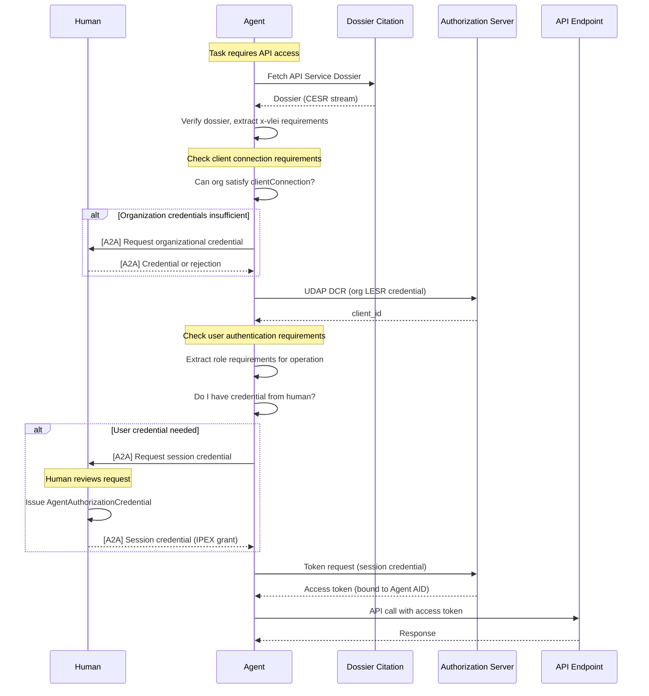
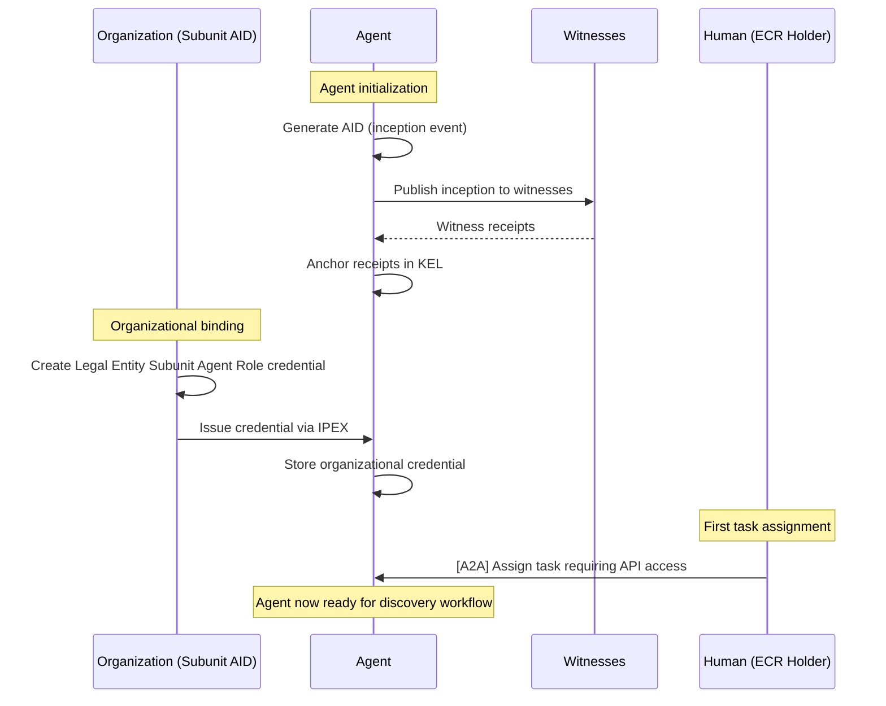
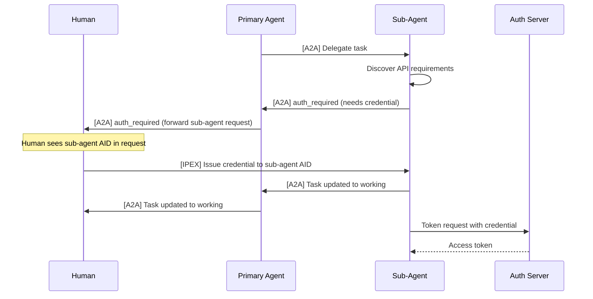

# API Discovery and Authorization for Agents

## Enabling autonomous agents to discover, authenticate, and access APIs on behalf of humans using vLEI credentials

**Status:** Draft v0.1 — for discussion
**Date:** 27 October 2026
**Intended audience:** VITAL Initiative participants; implementers of AI agents, agent orchestration frameworks, vLEI credential systems, and UDAP authorization servers
**Relationship to other documents:**
- Builds on [`Verifiable_Dossier_for_API_Services.md`](Verifiable_Dossier_for_API_Services.md) for API discovery and credential requirement extraction.
- Uses the UDAP vLEI profiles defined in [`udap-vlei-dynamic-client-registration.html`](udap-vlei-dynamic-client-registration.html) and [`udap-vlei-acdc-client-auth.html`](udap-vlei-acdc-client-auth.html).
- Integrates with the [A2A (Agent-to-Agent) Protocol](https://github.com/a2aproject/a2a) for credential requirement propagation.
- References the credential hierarchy in [`Credential-Hierarchy-Graph.md`](Credential-Hierarchy-Graph.md).

---

## 1. Abstract

AI agents increasingly need to access protected APIs on behalf of human users. In healthcare and other regulated domains, these APIs require verifiable organizational identity and role-based authorization through vLEI credentials. This specification defines how an autonomous agent can:

1. **Discover** available APIs and their credential requirements from an API Service Dossier
2. **Evaluate** whether its organization holds the credentials needed for client registration
3. **Request** from its supervising human the credentials needed for user-level authorization
4. **Register** as an OAuth client using UDAP vLEI Dynamic Client Registration
5. **Authenticate** at the token endpoint using credentials issued by the human
6. **Propagate** credential requirements through agent chains via the A2A protocol

The specification addresses the "human above the loop" pattern where agents operate autonomously but derive their authority from—and remain accountable to—a human who holds the ultimate vLEI-backed credentials.

---

## 2. Conventions and Terminology

The key words **MUST**, **MUST NOT**, **REQUIRED**, **SHALL**, **SHALL NOT**, **SHOULD**, **SHOULD NOT**, **RECOMMENDED**, **MAY** and **OPTIONAL** are interpreted as described in RFC 2119 and RFC 8174 when, and only when, they appear in all capitals.

| Term | Definition |
|---|---|
| **A2A** | Agent-to-Agent Protocol. An open standard for inter-agent communication using JSON-RPC over HTTP. |
| **Agent** | An autonomous software system with its own KERI AID that can discover APIs, request credentials, and make authenticated API calls. |
| **Agent Card** | A2A metadata document at `/.well-known/agent-card.json` describing an agent's capabilities and security requirements. |
| **Agent Credential** | An ACDC credential issued by a human to an agent, authorizing the agent to act on the human's behalf for specific purposes. |
| **API Service Dossier** | A Verifiable Dossier (ACDC) that publishes an organization's APIs, endpoints, and credential requirements. Defined in [`Verifiable_Dossier_for_API_Services.md`](Verifiable_Dossier_for_API_Services.md). |
| **Client Connection** | The set of organizational credentials needed to register an OAuth client and obtain any access token. |
| **Credential Requirement** | A machine-readable predicate specifying the schema, attributes, and chain constraints a credential must satisfy. |
| **Human Above the Loop** | The human who supervises an agent, holds authoritative vLEI credentials, and can issue credentials to authorize agent actions. |
| **Primary Agent** | The agent that directly interacts with a human; it may delegate tasks to sub-agents. |
| **Session Credential** | A short-lived ACDC credential issued by a human to an agent for the duration of a task or session. |
| **Sub-Agent** | An agent invoked by another agent to perform a specialized task. |
| **User Authentication** | The OAuth flow (typically authorization code) where credentials representing a specific human's authority are presented. |

---

## 3. Overview

### 3.1 The Agent Authorization Challenge

When an agent needs to call a protected API on behalf of a human:

1. **Discovery**: The agent must find the API and understand what credentials are required
2. **Organizational Authorization**: The agent's organization must satisfy client connection requirements (e.g., hold an LESR credential)
3. **User Authorization**: The agent must prove it acts on behalf of a specific human who has the required role
4. **Credential Gap**: The agent may not initially have the credentials it needs—it must request them from the human

Traditional OAuth flows assume a human is present to authenticate. Agent workflows require that the human pre-authorize the agent by issuing credentials that the agent can present autonomously.

### 3.2 Agent Identity Model

```
┌─────────────────────────────────────────────────────────────────────┐
│                     HUMAN ABOVE THE LOOP                            │
│                                                                     │
│  ┌──────────────┐     holds      ┌────────────────────────────┐    │
│  │  Human AID   │◄──────────────►│  ECR vLEI Credential       │    │
│  │              │                │  (Data Exchange Rep, etc.) │    │
│  └──────────────┘                └────────────────────────────┘    │
│         │                                                           │
│         │ issues (for session)                                      │
│         ▼                                                           │
│  ┌──────────────────────────────────────────────────────────┐      │
│  │              SESSION AGENT CREDENTIAL                     │      │
│  │  Schema: AgentAuthorizationCredential                     │      │
│  │  Issuee: Agent AID                                        │      │
│  │  Chains to: Human's ECR credential                        │      │
│  │  Attributes: scope, expiration, api constraints           │      │
│  └──────────────────────────────────────────────────────────┘      │
└─────────────────────────────────────────────────────────────────────┘
         │
         │ presented by
         ▼
┌─────────────────────────────────────────────────────────────────────┐
│                          AGENT                                       │
│                                                                      │
│  ┌──────────────┐                  ┌─────────────────────────┐      │
│  │  Agent AID   │                  │  Organization's LESR    │      │
│  │  (independent│◄─────────────────│  (via agent binding)    │      │
│  │   identity)  │                  │                         │      │
│  └──────────────┘                  └─────────────────────────┘      │
│                                                                      │
│  The agent authenticates as itself but presents credentials         │
│  that chain to both the organization AND the human.                 │
└─────────────────────────────────────────────────────────────────────┘
```

**Key principles:**

1. The agent has its own independent AID—it is not a delegate of the human's AID
2. The agent receives a session-scoped credential from the human that chains to the human's vLEI credential
3. Access tokens are bound to the agent's AID (the agent makes the API calls)
4. The credential chain provides an audit trail back to the authorizing human

### 3.3 Two-Phase Authorization Model

| Phase | Purpose | Credential Source | OAuth Flow |
|---|---|---|---|
| **Client Connection** | Establish the agent's organization as an authorized API consumer | Organization's LESR credential (via Legal Entity Subunit Agent Role binding) | UDAP Dynamic Client Registration |
| **User Authentication** | Authorize the agent to act on behalf of a specific human with specific roles | Session credential issued by the human, chaining to the human's ECR | Authorization Code or Client Credentials with user credential |

### 3.4 End-to-End Flow



---

## 4. API Discovery from Dossier

### 4.1 Obtaining the Dossier

An agent **MUST** discover the API Service Dossier before attempting to access an API. Discovery mechanisms include:

1. **UDAP Metadata**: The `vlei_dossier` field in `/.well-known/udap`
2. **Agent Card**: An A2A Agent Card may include a `vlei_dossier` field in its extensions
3. **Task Context**: A human or upstream agent may provide the dossier citation as part of a task
4. **Well-Known Location**: `/.well-known/vlei/dossier` at the API provider's domain

The agent **MUST**:
1. Resolve the dossier citation
2. Verify the dossier per §9 of the API Service Dossier specification
3. Verify the dossier's `authority` chain terminates at a trusted root

### 4.2 Extracting Credential Requirements

From a verified dossier, the agent extracts:

```
Dossier
└── apis.<name>
    └── spec (OpenAPI document)
        └── components.securitySchemes.<scheme>
            ├── x-udap
            │   ├── metadataUrl
            │   ├── registrationUrl
            │   └── trustModes
            └── x-vlei
                ├── acceptancePolicy
                │   ├── trustedRoots[]
                │   └── governedSchemas[]
                ├── clientConnection
                │   ├── match: "all" | "any"
                │   └── credentials[]
                │       ├── schema (SAID)
                │       ├── attributes (constraints)
                │       ├── holder: ["issuee", "agent", "delegate"]
                │       └── lei: "client" | "any" | "<specific LEI>"
                └── roles
                    └── <role-name>
                        ├── subject: "client" | "user"
                        └── credentials[]
```

### 4.3 Requirement Analysis Algorithm

```
ALGORITHM: Analyze API Credential Requirements

INPUT: Verified API Service Dossier, Target operation
OUTPUT: RequirementAnalysis {
  clientConnection: CredentialRequirement[],
  userRoles: Map<roleName, CredentialRequirement[]>,
  canSatisfyClientConnection: boolean,
  missingClientCredentials: CredentialRequirement[],
  missingUserCredentials: Map<roleName, CredentialRequirement[]>
}

1. spec ← Extract OpenAPI spec from dossier
2. scheme ← Find security scheme for target operation
3. vlei ← scheme.x-vlei

4. // Analyze client connection requirements
   clientReqs ← vlei.clientConnection.credentials
   FOR EACH req IN clientReqs:
     IF agent can satisfy req with existing org credentials:
       Mark req as SATISFIED
     ELSE:
       Add req to missingClientCredentials

5. // Analyze user role requirements
   security ← Get Security Requirement Object for operation
   FOR EACH roleName IN security scopes that match "role:*":
     role ← vlei.roles[roleName]
     IF role.subject == "user":
       FOR EACH req IN role.credentials:
         IF agent has valid session credential satisfying req:
           Mark req as SATISFIED
         ELSE:
           Add req to missingUserCredentials[roleName]

6. RETURN RequirementAnalysis
```

---

## 5. Client Connection (Phase 1)

### 5.1 Overview

Client connection establishes the agent's organization as an authorized API consumer. This is performed once (or periodically) and allows the agent to obtain access tokens for subsequent requests.

The agent authenticates using the organization's vLEI credentials, typically:
- A Legal Entity Subunit Role (LESR) vLEI Credential, or
- A Legal Entity Subunit Agent Role vLEI Credential that chains to an LESR

### 5.2 Agent Binding to Organizational Credentials

An agent **MUST** have one of the following relationships to satisfy organizational `clientConnection` requirements:

| Holder Binding | Agent Credential Chain |
|---|---|
| `issuee` | The agent's AID is the issuee of the LESR (rare for agents) |
| `agent` | The agent holds a **Legal Entity Subunit Agent Role vLEI Credential** whose `role` edge chains (`I2I`) to an LESR held by the organization |

Most agent deployments use the `agent` binding: the organization issues a Legal Entity Subunit Agent Role credential to the agent's AID, authorizing it to act on behalf of the subunit that holds the LESR.

### 5.3 Registration Flow

Per [`udap-vlei-dynamic-client-registration.html`](udap-vlei-dynamic-client-registration.html):

```
POST /register HTTP/1.1
Host: as.example.com
Content-Type: application/json

{
  "software_statement_type": "urn:ietf:params:oauth:client-assertion-type:acdc-vlei",
  "software_statement": "<CESR-encoded credential chain>",
  "udap": "1"
}
```

The `software_statement` **MUST** include:
1. The agent's Legal Entity Subunit Agent Role credential
2. The organization's LESR credential (via chain)
3. All intermediate credentials to the trusted root
4. KELs and TELs needed for verification

**Success Response:**
```json
{
  "client_id": "agent-client-abc123",
  "software_statement_type": "urn:ietf:params:oauth:client-assertion-type:acdc-vlei",
  "token_endpoint_auth_method": "acdc_vlei"
}
```

### 5.4 Handling Missing Organizational Credentials

If the agent's organization lacks the required credentials:

1. The agent **MUST NOT** attempt registration
2. The agent **SHOULD** report the requirement to the human via A2A (see §8)
3. The human or organization must obtain the credential through normal vLEI issuance channels
4. This is typically not a session-level operation—it requires organizational action

---

## 6. User Authentication (Phase 2)

### 6.1 Overview

User authentication authorizes the agent to exercise roles that require a specific human's authority. The dossier's `x-vlei.roles` with `subject: "user"` identify these requirements.

The agent presents a **session credential** issued by the human that:
- Is issued to the agent's AID
- Chains to the human's vLEI credential (e.g., ECR)
- Specifies the authorized scope and expiration

### 6.2 Session Credential Schema

The **Agent Authorization Credential** is an ACDC that authorizes an agent to act on behalf of a human:

```json
{
  "$schema": "https://json-schema.org/draft/2020-12/schema",
  "$id": "<Agent Authorization Credential schema SAID>",
  "title": "Agent Authorization Credential",
  "description": "Credential issued by a human to an agent, authorizing the agent to act on the human's behalf.",
  "credentialType": "AgentAuthorizationCredential",
  "version": "1.0.0",
  "type": "object",
  "required": ["v", "d", "i", "s", "a", "e"],
  "properties": {
    "a": {
      "type": "object",
      "required": ["d", "i", "dt", "purpose", "scope"],
      "properties": {
        "d": { "type": "string", "description": "Attributes block SAID" },
        "i": { "type": "string", "description": "Agent AID (issuee)" },
        "dt": { "type": "string", "format": "date-time", "description": "Issuance time" },
        "purpose": { "type": "string", "description": "Task or session description" },
        "scope": {
          "type": "array",
          "items": { "type": "string" },
          "description": "Authorized scopes/roles (e.g., 'role:care-coordinator')"
        },
        "apiConstraints": {
          "type": "array",
          "items": {
            "type": "object",
            "properties": {
              "dossierSaid": { "type": "string" },
              "apiName": { "type": "string" },
              "operations": { "type": "array", "items": { "type": "string" } }
            }
          },
          "description": "Optional: restrict authorization to specific APIs/operations"
        },
        "expiration": { "type": "string", "format": "date-time" },
        "maxUses": { "type": "integer", "description": "Optional: limit number of token requests" }
      }
    },
    "e": {
      "type": "object",
      "required": ["d", "authority"],
      "properties": {
        "authority": {
          "type": "object",
          "description": "Edge to the human's vLEI credential (e.g., ECR)",
          "required": ["n", "s", "o"],
          "properties": {
            "n": { "type": "string", "description": "Human's credential SAID" },
            "s": { "type": "string", "description": "Schema SAID (e.g., ECR schema)" },
            "o": { "const": "I2I", "description": "Issuer is issuee of target" }
          }
        }
      }
    }
  }
}
```

### 6.3 Token Request with Session Credential

Per [`udap-vlei-acdc-client-auth.html`](udap-vlei-acdc-client-auth.html):

```
POST /token HTTP/1.1
Host: as.example.com
Content-Type: application/x-www-form-urlencoded

grant_type=client_credentials&
client_id=agent-client-abc123&
scope=system/Patient.rs role:data-exchange-representative&
client_assertion_type=urn:ietf:params:oauth:client-assertion-type:acdc-vlei&
client_assertion=<CESR-encoded IPEX Grant with session credential>
```

The `client_assertion` (IPEX Grant) **MUST** include:
1. The Agent Authorization Credential issued by the human
2. The human's underlying vLEI credential (e.g., ECR)
3. The complete chain to the trusted root
4. Percolated discovery (`pd` field) for chain resolution

### 6.4 Authorization Server Validation

The authorization server **MUST**:

1. Verify the IPEX Grant signature (signed by agent's AID)
2. Verify the Agent Authorization Credential:
   - Issuee is the agent's AID (matches `client_id` binding)
   - Not expired
   - Scope includes requested roles
   - `apiConstraints` (if present) allow this API
3. Verify the `authority` chain:
   - Human's credential (e.g., ECR) is valid
   - Chain reaches trusted root
   - Human's credential satisfies the `subject: "user"` role requirements
4. Issue token with:
   - Granted scopes (intersection of requested and authorized)
   - `vlei.aid` = agent's AID
   - `vlei.humanAid` = human's AID (from authority chain)
   - `vlei.credentials` = SAIDs of presented credentials

### 6.5 Token Binding

The access token **MUST** be bound to the agent's AID because:
- The agent makes the API calls
- The agent's AID signed the token request
- Audit trails trace to both the agent and (via credential chain) the human

---

## 7. Agent Bootstrapping

### 7.1 Initial Agent Setup

Before an agent can participate in the workflows described above, it must:

1. **Create an AID**: The agent generates its own KERI identifier
2. **Publish OOBI**: The agent makes its AID discoverable via witnesses
3. **Obtain Organizational Binding**: The organization issues a Legal Entity Subunit Agent Role credential to the agent's AID
4. **Configure Trust Anchors**: The agent is configured with trusted root AIDs (e.g., GLEIF Root)

### 7.2 Bootstrapping Sequence



### 7.3 Organizational Credential Refresh

The agent's organizational binding (Legal Entity Subunit Agent Role credential) may expire or be revoked. The agent **MUST**:

1. Monitor credential status via TEL
2. Request renewal before expiration
3. Re-register with authorization servers after credential update

---

## 8. A2A Protocol Integration

### 8.1 Credential Requirement Artifact

When an agent discovers it needs a credential it doesn't have, it communicates this to the human via the A2A protocol. The requirement is conveyed as an **Artifact** within a Task.

**Credential Requirement Artifact Schema:**

```json
{
  "artifactId": "cred-req-<uuid>",
  "name": "Credential Requirement",
  "parts": [{
    "mimeType": "application/vnd.vital.credential-requirement+json",
    "data": {
      "version": "1.0",
      "type": "user-authentication",
      "api": {
        "dossierSaid": "EApiSvcDossier...",
        "dossierCitation": "https://provider.example/.well-known/vlei/dossier",
        "apiName": "providerAccess",
        "operation": "davinciDataExport",
        "endpoint": "https://api.provider.example/fhir/provider-access"
      },
      "requirement": {
        "schema": "EEy9PkikFcANV1l7EHukCeXqrzT1hNZjGlUk7wuMO5jw",
        "schemaOobi": "https://schema.gleif.org/oobi/EEy9PkikFcANV1l7EHukCeXqrzT1hNZjGlUk7wuMO5jw",
        "schemaName": "Engagement Context Role vLEI Credential",
        "attributes": {
          "engagementContextRole": {
            "enum": ["Data Exchange Representative"]
          },
          "LEI": {
            "const": "254900ABCDEFG1234567"
          }
        },
        "holder": ["issuee"]
      },
      "humanReadable": {
        "title": "Data Exchange Representative Authorization Required",
        "description": "To export patient data from Example Health Plan's Provider Access API, you must authorize this agent to act as your Data Exchange Representative. This requires you to hold a valid ECR credential with the 'Data Exchange Representative' role for your organization.",
        "actionRequired": "Please issue an Agent Authorization Credential to this agent with scope 'role:data-exchange-representative'."
      },
      "agentInfo": {
        "agentAid": "EAgentAid...",
        "agentOobi": "https://agent.example/oobi/EAgentAid.../witness",
        "sessionId": "task-<uuid>",
        "requestedScopes": ["role:data-exchange-representative"],
        "requestedExpiration": "2026-10-28T00:00:00Z"
      }
    }
  }]
}
```

### 8.2 Task State: AUTH_REQUIRED

When an agent needs credentials, it transitions its A2A Task to the `auth_required` state:

```json
{
  "jsonrpc": "2.0",
  "method": "tasks/send",
  "params": {
    "taskId": "task-<uuid>",
    "message": {
      "role": "agent",
      "parts": [{
        "mimeType": "text/plain",
        "text": "I need authorization to access the Provider Access API on your behalf."
      }]
    },
    "artifacts": [{
      "artifactId": "cred-req-<uuid>",
      "name": "Credential Requirement",
      "parts": [{ "...": "as above" }]
    }],
    "state": "auth_required"
  }
}
```

### 8.3 Human Response Flow

The human's client (or a credential management agent) receives the `auth_required` task and:

1. **Reviews** the credential requirement artifact
2. **Validates** that they hold the required underlying credential (e.g., ECR)
3. **Decides** whether to authorize the agent
4. **Issues** an Agent Authorization Credential to the agent's AID
5. **Delivers** the credential via IPEX Grant
6. **Updates** the A2A task to `working` state with confirmation

```json
{
  "jsonrpc": "2.0",
  "method": "tasks/send",
  "params": {
    "taskId": "task-<uuid>",
    "message": {
      "role": "user",
      "parts": [{
        "mimeType": "text/plain",
        "text": "Authorization granted. Credential issued."
      }]
    },
    "artifacts": [{
      "artifactId": "cred-grant-<uuid>",
      "name": "Credential Grant Confirmation",
      "parts": [{
        "mimeType": "application/vnd.vital.credential-grant+json",
        "data": {
          "credentialSaid": "EAgentAuthCred...",
          "deliveryMethod": "ipex",
          "ipexGrantSaid": "EIpexGrant..."
        }
      }]
    }]
  }
}
```

### 8.4 Sub-Agent Credential Propagation

When a primary agent delegates a task to a sub-agent that requires API access:

1. The sub-agent discovers the API requirements (same as primary agent)
2. The sub-agent requests credentials via A2A from the primary agent
3. The primary agent **MUST** propagate the request to the human
4. The human **MUST** issue credentials directly to the sub-agent's AID

**Rationale:** Credentials bind authorization to a specific AID. The sub-agent cannot use the primary agent's credentials because:
- The credentials are issued to the primary agent's AID
- The sub-agent would fail holder binding validation
- Audit trails would be compromised



### 8.5 Multi-Hop Propagation

In complex agent networks, credential requests may traverse multiple hops:

```
Human ← Agent A ← Agent B ← Agent C (needs credential)
```

Each agent in the chain **MUST**:
1. Preserve the original `agentInfo.agentAid` (Agent C's AID)
2. Forward the credential requirement artifact unchanged
3. Track the request for correlation

The human issues the credential directly to Agent C's AID, regardless of the chain depth.

---

## 9. Credential Revocation

### 9.1 Revocation Scenarios

| Scenario | Trigger | Effect |
|---|---|---|
| Human revokes session credential | Human revokes in TEL | Agent can no longer obtain new tokens; existing tokens remain valid until expiry |
| Organization revokes agent binding | Subunit revokes Agent Role credential in TEL | Agent can no longer register or authenticate; existing tokens remain valid |
| Human's underlying credential revoked | QVI or LE revokes ECR in TEL | All session credentials that chain to it become invalid |
| Agent AID compromised | Agent or organization rotates AID | All credentials issued to old AID are invalid |

### 9.2 Agent Revocation Monitoring

Agents **MUST** monitor the status of:
1. Their own organizational binding credential
2. Any session credentials they hold
3. The credentials those session credentials chain to

Monitoring is performed via TEL status queries to watchers.

### 9.3 Authorization Server Revocation Checks

Per the `statusCheck` policy in the dossier's `x-vlei.acceptancePolicy`:

| Policy | Behavior |
|---|---|
| `token-issuance` (default) | Check credential status at each token request |
| `registration` | Check only at DCR; subsequent tokens trust registration |

Authorization servers **SHOULD** use `token-issuance` for sensitive APIs.

### 9.4 Mid-Session Revocation

If a credential is revoked while an agent holds a valid access token:

1. The agent may complete in-flight requests
2. The agent will fail to refresh or obtain new tokens
3. Resource servers performing per-request status checks will reject requests
4. The agent **SHOULD** report the revocation to the human via A2A

---

## 10. Audit Trail

### 10.1 Audit Requirements

Every agent API call **MUST** be traceable to:
1. The agent's AID (token binding)
2. The authorizing human's AID (credential chain)
3. The organization's LEI (credential chain)
4. The specific credentials presented (token claims)

### 10.2 Token Claims for Audit

Access tokens **SHOULD** include:

```json
{
  "vlei": {
    "aid": "EAgentAid...",
    "humanAid": "EHumanAid...",
    "lei": "254900ABCDEFG1234567",
    "roles": ["role:data-exchange-representative"],
    "credentials": [
      "EAgentAuthCred...",
      "EHumanECR...",
      "EOrgLESR..."
    ],
    "sessionPurpose": "Bulk export of attributed patient data"
  }
}
```

### 10.3 A2A Task Correlation

Each credential request and grant **SHOULD** be correlated with:
- The A2A task ID
- The API operation that required it
- Timestamps for request and grant

This correlation enables audit of:
- What the agent was trying to do
- Why it needed the credential
- When the human authorized it
- What the agent did with the authorization

### 10.4 Resource Server Logging

Resource servers **SHOULD** log:
1. The `vlei` claims from the access token
2. The API operation performed
3. The data accessed or modified
4. Timestamp and request correlation ID

---

## 11. Security Considerations

### 11.1 Session Credential Scope Limitation

Humans **SHOULD** issue session credentials with minimal scope:
- Limit to specific roles needed for the task
- Include `apiConstraints` to restrict to specific APIs
- Set short expiration times
- Consider `maxUses` for one-time operations

### 11.2 Agent Compromise

If an agent is compromised:
1. **Immediate**: Revoke all credentials issued to the agent's AID
2. **Short-term**: The agent cannot obtain new tokens
3. **Limitation**: Existing tokens remain valid until expiry
4. **Mitigation**: Use short token lifetimes; enable per-request status checks

### 11.3 Human Credential Theft

If a human's private key is compromised:
1. The human rotates their AID (key rotation event)
2. Credentials issued by the old key state remain valid until explicitly revoked
3. The human **MUST** revoke all session credentials issued to agents
4. The human **SHOULD** request new ECR issuance to the rotated AID

### 11.4 Sub-Agent Trust

Primary agents **MUST NOT**:
- Share their credentials with sub-agents
- Issue credentials to sub-agents (only humans may issue)
- Accept sub-agent claims of holding credentials without verification

### 11.5 Replay Protection

Session credentials include:
- Issuance timestamp (`dt`)
- Expiration time
- Unique SAID (content-addressed)

IPEX Grants for token requests include:
- Nonce/replay protection per the UDAP spec
- Audience binding to the token endpoint

---

## 12. Implementation Notes

### 12.1 Agent Credential Cache

Agents **SHOULD** cache:
- Verified dossiers (with TTL based on `prev` checks)
- Registration (`client_id`) per authorization server
- Session credentials (until expiration)

### 12.2 Parallel Registration

An agent may register with multiple authorization servers concurrently if:
- Each API provider has its own dossier
- The agent's organizational credentials satisfy each provider's requirements

### 12.3 Credential Pre-Fetching

For predictable workflows, humans **MAY** pre-issue session credentials:
- Before the agent encounters `auth_required`
- With appropriate scope and expiration
- Delivered via IPEX before task start

### 12.4 Agent Card Extensions

Agents **SHOULD** advertise their vLEI capabilities in their A2A Agent Card:

```json
{
  "name": "Healthcare Data Agent",
  "extensions": {
    "vlei": {
      "version": "1.0",
      "agentAid": "EAgentAid...",
      "agentOobi": "https://agent.example/oobi/EAgentAid.../witness",
      "organizationLei": "254900ABCDEFG1234567",
      "supportedCredentialSchemas": [
        "EEy9PkikFcANV1l7EHukCeXqrzT1hNZjGlUk7wuMO5jw",
        "EHfJ563sbivepFRzk506fJenWIeVG2uXdAes8iJhHJan"
      ],
      "credentialRequestSupported": true
    }
  }
}
```

---

## 13. References

- [Verifiable Dossier for API Services](Verifiable_Dossier_for_API_Services.md)
- [UDAP vLEI Dynamic Client Registration](udap-vlei-dynamic-client-registration.html)
- [UDAP vLEI ACDC Client Authentication](udap-vlei-acdc-client-auth.html)
- [Credential Hierarchy Graph](Credential-Hierarchy-Graph.md)
- [A2A Protocol](https://github.com/a2aproject/a2a) — Agent-to-Agent Protocol Specification
- [A2A Protocol Technical Overview](https://tyk.io/learning-center/a2a-protocol-architecture-and-technical-specification/)
- KERI Specification — Key Event Receipt Infrastructure
- ACDC Specification — Authentic Chained Data Containers
- IPEX Specification — Issuance and Presentation Exchange Protocol
- GLEIF vLEI Ecosystem Governance Framework

---

## Appendix A. Credential Requirement Artifact JSON Schema

```json
{
  "$schema": "https://json-schema.org/draft/2020-12/schema",
  "$id": "https://vital.example/schema/a2a/credential-requirement/1.0",
  "title": "A2A Credential Requirement Artifact",
  "type": "object",
  "required": ["version", "type", "api", "requirement", "humanReadable", "agentInfo"],
  "properties": {
    "version": { "const": "1.0" },
    "type": {
      "enum": ["client-connection", "user-authentication"],
      "description": "Whether this is for DCR or user auth flow"
    },
    "api": {
      "type": "object",
      "required": ["dossierSaid", "apiName", "operation"],
      "properties": {
        "dossierSaid": { "type": "string" },
        "dossierCitation": { "type": "string", "format": "uri" },
        "apiName": { "type": "string" },
        "operation": { "type": "string" },
        "endpoint": { "type": "string", "format": "uri" }
      }
    },
    "requirement": {
      "type": "object",
      "required": ["schema"],
      "properties": {
        "schema": { "type": "string", "description": "Required credential schema SAID" },
        "schemaOobi": { "type": "string", "format": "uri" },
        "schemaName": { "type": "string" },
        "attributes": {
          "type": "object",
          "additionalProperties": {
            "oneOf": [
              { "type": "object", "properties": { "const": {} } },
              { "type": "object", "properties": { "enum": { "type": "array" } } },
              { "type": "object", "properties": { "pattern": { "type": "string" } } }
            ]
          }
        },
        "holder": {
          "type": "array",
          "items": { "enum": ["issuee", "agent", "delegate"] }
        }
      }
    },
    "humanReadable": {
      "type": "object",
      "required": ["title", "description", "actionRequired"],
      "properties": {
        "title": { "type": "string" },
        "description": { "type": "string" },
        "actionRequired": { "type": "string" }
      }
    },
    "agentInfo": {
      "type": "object",
      "required": ["agentAid", "agentOobi"],
      "properties": {
        "agentAid": { "type": "string" },
        "agentOobi": { "type": "string", "format": "uri" },
        "sessionId": { "type": "string" },
        "requestedScopes": { "type": "array", "items": { "type": "string" } },
        "requestedExpiration": { "type": "string", "format": "date-time" }
      }
    }
  }
}
```

---

## Appendix B. Example: Complete Agent Workflow

This example traces an agent through the complete workflow of accessing a Provider Access API.

### B.1 Initial State

- **Agent**: `EAgentAid...` with Legal Entity Subunit Agent Role credential
- **Human**: `EHumanAid...` holds ECR with role "Data Exchange Representative"
- **Organization**: LEI `254900ABCDEFG1234567`, holds LESR for ONC Care Coordination

### B.2 Task Assignment

Human assigns task via A2A:
```json
{
  "method": "tasks/send",
  "params": {
    "message": {
      "role": "user",
      "parts": [{
        "text": "Export all patient data for our attributed members from Example Health Plan."
      }]
    }
  }
}
```

### B.3 Dossier Discovery

Agent fetches dossier from `https://examplehealth.example/.well-known/vlei/dossier`

Extracts requirements for `davinciDataExport` operation:
- **clientConnection**: LESR with `endorsementCode: T-HCO-CC` ✓ (org has this)
- **role:data-exchange-representative**: ECR with `engagementContextRole: Data Exchange Representative`, `subject: user` ✗ (agent needs credential from human)

### B.4 Client Registration

Agent registers with authorization server:
```
POST https://auth.examplehealth.example/register
{
  "software_statement_type": "urn:ietf:params:oauth:client-assertion-type:acdc-vlei",
  "software_statement": "<CESR: Agent Role → LESR → LESR Auth → LE vLEI → QVI>",
  "udap": "1"
}
```

Response: `{ "client_id": "agent-client-abc123" }`

### B.5 Credential Request

Agent sends A2A message with `auth_required` state and credential requirement artifact (as shown in §8.1).

### B.6 Human Authorization

Human reviews request, issues Agent Authorization Credential:
```json
{
  "v": "ACDC10JSON...",
  "d": "EAgentAuthCred...",
  "i": "EHumanAid...",
  "s": "<Agent Authorization Credential schema>",
  "a": {
    "d": "EAttrs...",
    "i": "EAgentAid...",
    "dt": "2026-10-27T10:00:00Z",
    "purpose": "Export attributed patient data from Example Health Plan",
    "scope": ["role:data-exchange-representative"],
    "apiConstraints": [{
      "dossierSaid": "EApiSvcDossier...",
      "apiName": "providerAccess",
      "operations": ["davinciDataExport"]
    }],
    "expiration": "2026-10-27T12:00:00Z"
  },
  "e": {
    "d": "EEdges...",
    "authority": {
      "n": "EHumanECR...",
      "s": "EEy9PkikFcANV1l7EHukCeXqrzT1hNZjGlUk7wuMO5jw",
      "o": "I2I"
    }
  }
}
```

Delivered via IPEX Grant to agent.

### B.7 Token Request

Agent requests token:
```
POST https://auth.examplehealth.example/token
grant_type=client_credentials&
client_id=agent-client-abc123&
scope=system/Group.rs role:data-exchange-representative&
client_assertion_type=urn:ietf:params:oauth:client-assertion-type:acdc-vlei&
client_assertion=<CESR: IPEX Grant with Agent Auth Cred → ECR → ... chain>
```

Response:
```json
{
  "access_token": "eyJ...",
  "token_type": "Bearer",
  "expires_in": 3600,
  "scope": "system/Group.rs role:data-exchange-representative"
}
```

### B.8 API Call

Agent calls API:
```
POST https://api.examplehealth.example/fhir/provider-access/Group/group-123/$davinci-data-export
Authorization: Bearer eyJ...
```

### B.9 Task Completion

Agent reports completion via A2A with export results as artifacts.
