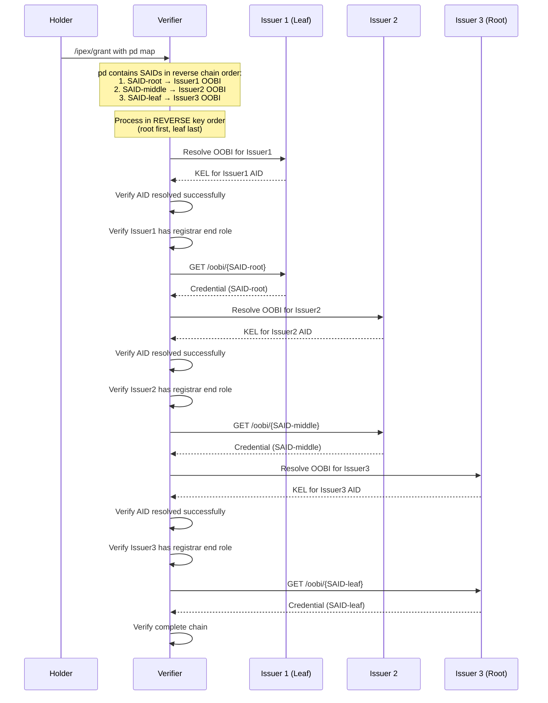

# Extended IPEX for Percolated Discovery

## Enabling credential chain resolution through the `pd` field in `/ipex/grant` messages

**Status:** Draft v0.1 — for discussion
**Date:** 27 October 2026
**Intended audience:** VITAL Initiative participants; implementers of KERI agents, vLEI credential verifiers, and IPEX protocol handlers
**Relationship to other documents:**
- Extends the IPEX (Issuance and Presentation Exchange) protocol as defined in the KERI specification.
- Supports credential chain verification as described in [`Credential-Hierarchy-Graph.md`](Credential-Hierarchy-Graph.md).
- Complements the credential presentation flow in [`UDAP_vLEI_Onboarding_Intake_Design.md`](UDAP_vLEI_Onboarding_Intake_Design.md).

---

## 1. Abstract

When a credential is presented via an IPEX `/ipex/grant` message, the verifier must be able to verify the entire credential chain from the presented credential (the leaf) up to a trusted root. The **Percolated Discovery** extension adds a `pd` field to the `/ipex/grant` message that provides the verifier with all necessary information to discover and resolve every credential in the chain without prior knowledge of the issuers or their endpoints.

This specification defines:
- The structure of the `pd` (Percolated Discovery) field
- The ordering semantics of credential SAIDs within the `pd` map
- The resolution algorithm for loading the complete credential chain
- Requirements for issuers to support percolated discovery via the `registrar` end role

---

## 2. Conventions and Terminology

The key words **MUST**, **MUST NOT**, **REQUIRED**, **SHALL**, **SHALL NOT**, **SHOULD**, **SHOULD NOT**, **RECOMMENDED**, **MAY** and **OPTIONAL** are interpreted as described in RFC 2119 and RFC 8174 when, and only when, they appear in all capitals.

| Term | Definition |
|---|---|
| **ACDC** | Authentic Chained Data Container. A verifiable credential whose identifier is a SAID and whose provenance is anchored in a KERI KEL or TEL. |
| **AID** | KERI Autonomic Identifier. |
| **Credential Chain** | The sequence of credentials from a leaf credential up to a trusted root, where each credential's edge references the next credential in the chain. |
| **End Role** | A KERI role authorization that grants an AID the ability to act in a specific capacity, such as `witness`, `watcher`, or `registrar`. |
| **IPEX** | Issuance and Presentation Exchange. The KERI protocol for exchanging credentials between parties. |
| **Leaf Credential** | The credential being granted or presented, which is at the end of the credential chain. |
| **OOBI** | Out-Of-Band Introduction. A URL that enables discovery of KERI identifiers and their associated data. |
| **Percolated Discovery** | The process of resolving a credential chain by recursively discovering each credential's issuer and fetching the credential from the issuer's registrar endpoint. |
| **Registrar** | An endpoint service that provides access to credentials issued by an AID, typically via HTTP/HTTPS. |
| **Root Credential** | The credential at the top of the chain, issued by a trusted root AID (e.g., GLEIF Root or a QVI). |
| **SAID** | Self-Addressing IDentifier. A cryptographic digest embedded in the content it identifies. |
| **TEL** | Transaction Event Log. A verifiable log that tracks the issuance and revocation status of credentials. |

---

## 3. Overview

### 3.1 The Problem

When a holder presents a credential to a verifier via IPEX, the verifier must verify the complete credential chain. In hierarchical credential ecosystems like vLEI, this chain may include:

1. The presented credential (e.g., Legal Entity Subunit Role vLEI Credential)
2. An authorization credential (e.g., LESR Authorization vLEI Credential)
3. A legal entity credential (e.g., Legal Entity vLEI Credential)
4. A QVI credential (e.g., Qualified vLEI Issuer vLEI Credential)
5. (Implicit) The GLEIF Root AID

Without prior knowledge of the issuers in the chain, the verifier cannot discover where to fetch each credential. The `pd` field solves this by providing issuer OOBIs for every credential in the chain.

### 3.2 The Solution

The `/ipex/grant` message includes a `pd` (Percolated Discovery) map that contains:

- **Keys**: The SAIDs of all credentials in the chain, in **reverse order** (from leaf toward root)
- **Values**: Objects containing the issuer AID (`i`) and an OOBI (`o`) for resolving that issuer

The verifier processes the `pd` entries in **reverse key order** (root to leaf), resolving each issuer's AID and fetching the corresponding credential from the issuer's registrar endpoint.

### 3.3 Architecture



---

## 4. The `pd` Field Structure

### 4.1 Location

The `pd` field is located in the attributes block (`a`) of the `/ipex/grant` EXN message:

```json
{
  "v": "KERI10JSON000xxx_",
  "t": "exn",
  "d": "<message SAID>",
  "i": "<sender AID>",
  "r": "/ipex/grant",
  "a": {
    "m": "",
    "d": "<credential SAID being granted>",
    "i": "<issuee AID>",
    "pd": {
      "<credential-SAID-1>": { "i": "<issuer-AID-1>", "o": "<issuer-OOBI-1>" },
      "<credential-SAID-2>": { "i": "<issuer-AID-2>", "o": "<issuer-OOBI-2>" },
      ...
    }
  },
  "e": {
    "acdc": { ... }
  }
}
```

### 4.2 Field Definitions

| Field | Type | Required | Description |
|---|---|---|---|
| `pd` | object | REQUIRED | Percolated Discovery map. Keys are credential SAIDs; values are discovery objects. |
| `pd.<SAID>` | object | — | Discovery information for the credential identified by `<SAID>`. |
| `pd.<SAID>.i` | string | REQUIRED | The AID of the issuer of the credential identified by `<SAID>`. |
| `pd.<SAID>.o` | string | REQUIRED | An OOBI URL for resolving the issuer AID. This OOBI **SHOULD** include the `/registrar` role suffix. |

### 4.3 Key Ordering

The keys in the `pd` map **MUST** be ordered in **reverse chain order**, meaning:

1. The **first key** corresponds to the **leaf credential** (the credential being granted)
2. The **last key** corresponds to the credential closest to the **root** of the chain

This ordering reflects the natural direction of credential issuance: the root issues to the next level, which issues to the next, and so on down to the leaf.

> **Note:** While JSON objects do not guarantee key ordering, implementations **MUST** preserve insertion order when constructing the `pd` map, and verifiers **SHOULD** process keys in the order they appear (which will be reverse chain order).

### 4.4 Credential Coverage

The `pd` map **MUST** include an entry for every credential in the chain that the verifier needs to fetch, **except**:

- Credentials that the verifier already has (e.g., a well-known root credential)
- The credential embedded in the `e.acdc` block of the grant message itself

Implementations **SHOULD** include all chain credentials to ensure verifiers without prior state can resolve the complete chain.  If a verifier has already resolved a credential in the chain, the verifier ** MUST NOT *** load that credential and ** SHOULD ** check its revocation status.

---

## 5. Example

The following example is taken from a real `/ipex/grant` message granting a Legal Entity Subunit Role (LESR) vLEI Credential:

```json
{
  "v": "KERI10JSON000bb5_",
  "t": "exn",
  "d": "EMubFyZ3PlTBBiQAE5_VhrOIbIX9ZOeKk1vnOYp4wNdr",
  "i": "ELT-x_NS347dV23id0y0xbUcecwyv9Ecr5t2c5pDNM4G",
  "r": "/ipex/grant/ex",
  "a": {
    "m": "",
    "d": "EH9vL0vuVDdjPx0-SVzm_j0ob_0VOXyxtcqMAo9MnMhZ",
    "i": "EFuzv-bG0g672ddljEGYl2nRQK9Ao2HZTQeYOT5xCt31",
    "pd": {
      "EH9vL0vuVDdjPx0-SVzm_j0ob_0VOXyxtcqMAo9MnMhZ": {
        "i": "EK4IkBaWvVlkfiscv4w_cOEmGcfnbbumi_Q5fMh_HYO1",
        "o": "http://127.0.0.1:5642/oobi/EK4IkBaWvVlkfiscv4w_cOEmGcfnbbumi_Q5fMh_HYO1/registrar"
      },
      "EMj4mN6-ANKu0yLFjCdc6R5Ut-f_BGUri8EA3E0Rv66y": {
        "i": "EOLFfbVNcs5nTteFVvNiTZywW2_i-AY6X2Xji9cAZdKT",
        "o": "http://127.0.0.1:5642/oobi/EOLFfbVNcs5nTteFVvNiTZywW2_i-AY6X2Xji9cAZdKT/registrar"
      },
      "EHXC7bFQGyFzF99tu0Lj2mDtBkExPbIziQkzNkFSp7Rk": {
        "i": "EOLFfbVNcs5nTteFVvNiTZywW2_i-AY6X2Xji9cAZdKT",
        "o": "http://127.0.0.1:5642/oobi/EOLFfbVNcs5nTteFVvNiTZywW2_i-AY6X2Xji9cAZdKT/registrar"
      },
      "EBE38PsL_AtUJdfY7H_VN0Cv9jQSd1t7KjVFLX2C6gmo": {
        "i": "EK4IkBaWvVlkfiscv4w_cOEmGcfnbbumi_Q5fMh_HYO1",
        "o": "http://127.0.0.1:5642/oobi/EK4IkBaWvVlkfiscv4w_cOEmGcfnbbumi_Q5fMh_HYO1/registrar"
      },
      "ECSwWlVflRchb86OI3V7D_E3Kmsd8BEIHZz7bxiTUQNz": {
        "i": "EE9CDfykPbT--_v5i8HhSS8qj47YTOrumUkrvxLXSj2R",
        "o": "http://127.0.0.1:5642/oobi/EE9CDfykPbT--_v5i8HhSS8qj47YTOrumUkrvxLXSj2R/registrar"
      }
    }
  },
  "e": {
    "acdc": {
      "v": "ACDC10JSON000672_",
      "d": "EH9vL0vuVDdjPx0-SVzm_j0ob_0VOXyxtcqMAo9MnMhZ",
      "i": "EK4IkBaWvVlkfiscv4w_cOEmGcfnbbumi_Q5fMh_HYO1",
      "s": "EHfJ563sbivepFRzk506fJenWIeVG2uXdAes8iJhHJan",
      "a": { ... },
      "e": {
        "d": "EJM9zFJG-H4kY0XngFN0TId1Wc-HKuSDs96gdgYgxMd-",
        "auth": {
          "n": "EMj4mN6-ANKu0yLFjCdc6R5Ut-f_BGUri8EA3E0Rv66y",
          "s": "ECoqb1jxC9f9zwh664stMAy6gpnNduvP_3SCQlLvkPAR",
          "o": "I2I"
        }
      }
    }
  }
}
```

### 5.1 Chain Interpretation

In this example, the credential chain (from leaf to root) is:

| Order | Credential SAID | Credential Type | Issuer AID |
|---|---|---|---|
| 1 (Leaf) | `EH9vL0vuVDdjPx0-...` | LESR vLEI Credential | `EK4IkBaWvVlkfisc...` |
| 2 | `EMj4mN6-ANKu0yLF...` | LESR Authorization | `EOLFfbVNcs5nTteF...` |
| 3 | `EHXC7bFQGyFzF99t...` | Legal Entity Subunit vLEI | `EOLFfbVNcs5nTteF...` |
| 4 | `EBE38PsL_AtUJdfY...` | Legal Entity vLEI | `EK4IkBaWvVlkfisc...` |
| 5 (Root) | `ECSwWlVflRchb86O...` | QVI vLEI Credential | `EE9CDfykPbT--_v5...` |

The verifier processes these in the order listed (which is the reverse of the issuance chain).

---

## 6. Resolution Algorithm

### 6.1 Prerequisites

Before processing the `pd` field, the verifier **MUST**:

1. Verify the IPEX grant message signature
2. Extract the `pd` map from the attributes block
3. Have access to a KERI agent capable of OOBI resolution and KEL verification

### 6.2 Processing Steps

For each entry in the `pd` map, processed in **reverse key order** (first key to last key):

```
ALGORITHM: Percolated Discovery Resolution

INPUT: pd map from /ipex/grant message
OUTPUT: Set of verified credentials forming the complete chain

1. credentials ← empty set
2. keys ← ordered list of keys from pd map

3. FOR EACH said IN keys:
   3.1. entry ← pd[said]
   3.2. issuer_aid ← entry.i
   3.3. issuer_oobi ← entry.o

   // Step A: Resolve the issuer's OOBI
   3.4. RESOLVE issuer_oobi
   3.5. IF resolution fails:
         RETURN ERROR "Failed to resolve OOBI for issuer {issuer_aid}"

   // Step B: Verify the AID was resolved successfully
   3.6. key_state ← GET current key state for issuer_aid
   3.7. IF key_state is NULL or invalid:
         RETURN ERROR "AID {issuer_aid} not resolved"

   // Step C: Verify the issuer has declared a registrar end role
   3.8. end_roles ← GET end role authorizations for issuer_aid
   3.9. IF "registrar" NOT IN end_roles:
         RETURN ERROR "Issuer {issuer_aid} has no registrar end role"

   // Step D: Get the registrar endpoint
   3.10. registrar_endpoint ← GET HTTP/HTTPS endpoint for issuer_aid registrar role
   3.11. IF registrar_endpoint is NULL:
          RETURN ERROR "No registrar endpoint for {issuer_aid}"

   // Step E: Fetch the credential using the SAID
   3.12. credential_url ← registrar_endpoint + "/oobi/" + said
   3.13. credential_response ← HTTP GET credential_url
   3.14. IF credential_response.status ≠ 200:
          RETURN ERROR "Failed to fetch credential {said}"

   // Step F: Parse and verify the credential
   3.15. credential ← PARSE credential_response.body as CESR
   3.16. VERIFY credential.d == said
   3.17. VERIFY credential.i == issuer_aid
   3.18. VERIFY credential signature against issuer key state
   3.19. VERIFY credential TEL status (not revoked)

   3.20. ADD credential TO credentials

4. RETURN credentials
```

### 6.3 Verification After Resolution

After resolving all credentials, the verifier **MUST**:

1. **Verify chain integrity**: Each credential's edge references **MUST** point to a credential that was resolved
2. **Verify chain termination**: The chain **MUST** terminate at a trusted root AID
3. **Verify issuee binding**: For `I2I` (Issuer-to-Issuee) edges, the issuee of the referencing credential **MUST** equal the issuer of the referenced credential
4. **Verify all credentials are valid**: Status checks via TEL, signatures verified, not expired

---

## 7. Issuer Requirements

### 7.1 Registrar End Role

Every issuer that participates in percolated discovery **MUST**:

1. **Declare a registrar end role** in their KEL by issuing an end role authorization (`rpy` message with role `registrar`)
2. **Operate an HTTP or HTTPS endpoint** that serves credentials

### 7.2 Credential Endpoint

The registrar endpoint **MUST** support the following request:

```
GET /oobi/{credential-said}
```

Where `{credential-said}` is the SAID of a credential issued by the AID.

**Response:**

- **200 OK**: Returns the credential and its associated data as `application/cesr`
- **404 Not Found**: The credential SAID is unknown
- **410 Gone**: The credential has been revoked (OPTIONAL; verifier should check TEL)

The response **SHOULD** include:
- The ACDC credential
- The credential's TEL (issuance and any revocation events)
- The issuer's KEL (or sufficient key state)

### 7.3 OOBI Format

The OOBI provided in the `pd` field **SHOULD** use the registrar role suffix:

```
http[s]://{host}:{port}/oobi/{issuer-aid}/registrar
```

This allows the verifier to:
1. Resolve the issuer's AID
2. Discover the registrar endpoint in one operation

---

## 8. Security Considerations

### 8.1 OOBI Trust

The OOBIs in the `pd` field are provided by the holder, not by a trusted party. Verifiers **MUST NOT** trust the OOBI URLs themselves; they **MUST** verify:

1. The resolved AID matches the `i` field in the `pd` entry
2. The AID's key state is consistent and valid
3. The credential fetched from the registrar has the correct SAID and issuer

### 8.2 Man-in-the-Middle

An attacker could potentially:
- Provide a malicious OOBI that resolves to an attacker-controlled AID
- Serve a fraudulent credential from a malicious registrar

These attacks are mitigated because:
- The credential SAID is a cryptographic commitment; a fraudulent credential cannot match the expected SAID
- The credential signature must verify against the issuer's key state, which chains to a trusted root

### 8.3 Denial of Service

A malicious holder could provide OOBIs that:
- Point to non-existent hosts (causing timeouts)
- Point to slow endpoints (causing delays)
- Require excessive redirects

Verifiers **SHOULD**:
- Implement reasonable timeouts for OOBI resolution and credential fetching
- Limit the maximum chain depth
- Cache resolved AIDs and credentials to avoid redundant fetches

### 8.4 Privacy

The `pd` field reveals:
- The SAIDs of all credentials in the chain
- The AIDs of all issuers in the chain
- The OOBI endpoints of all issuers

This information may be sensitive in some contexts. Holders **SHOULD** be aware that presenting a credential via IPEX with percolated discovery exposes this information to the verifier.

---

## 9. Implementation Notes

### 9.1 Caching

Verifiers **SHOULD** cache:
- Resolved AID key states (with appropriate TTL)
- Fetched credentials (keyed by SAID)
- TEL status (with short TTL for revocation checks)

This improves performance for repeated verifications and reduces load on issuer endpoints.

### 9.2 Parallel Resolution

The resolution algorithm in §6.2 is presented sequentially for clarity. Implementations **MAY** resolve multiple entries in parallel, provided they maintain the logical ordering for chain verification.

### 9.3 Partial Resolution

If a verifier already has some credentials in the chain (e.g., from a previous verification or from a well-known root), it **MAY** skip resolution for those entries. The verifier **MUST** still verify that the pre-existing credentials match the expected SAIDs.

### 9.4 Error Handling

When resolution fails for any entry, the verifier **SHOULD**:
1. Log the specific failure (OOBI resolution, endpoint unavailable, credential not found, etc.)
2. Return a clear error to the presenter indicating which credential could not be resolved
3. Not partially accept the presentation

### 9.5 Watchers and Watcher Networks

Verifiers ** SHOULD ** add newly discovered Issuer AIDs to their list of watched AIDs via a local watcher and a Watcher Network of their choosing.  This ensures that verification of future credentials from the same issuer resolve more quickly because the Verifier has up to date keystate.

---

## 10. Relationship to Other Specifications

### 10.1 IPEX Protocol

This specification extends the IPEX `/ipex/grant` message format. Implementations that do not support percolated discovery **MAY** ignore the `pd` field and rely on other mechanisms (e.g., pre-shared credentials, out-of-band exchange) to resolve the credential chain.

### 10.2 OOBI Specification

The `pd` field leverages standard KERI OOBIs. The registrar role and endpoint discovery follow the KERI end role authorization mechanism.

### 10.3 ACDC Specification

The credentials resolved via percolated discovery are standard ACDCs. This specification does not modify ACDC structure or semantics.

---

## 11. References

- KERI Specification — Key Event Receipt Infrastructure
- ACDC Specification — Authentic Chained Data Containers
- IPEX Specification — Issuance and Presentation Exchange Protocol
- OOBI Specification — Out-Of-Band Introduction
- GLEIF vLEI Ecosystem Governance Framework
- VITAL — [`Credential-Hierarchy-Graph.md`](Credential-Hierarchy-Graph.md), [`UDAP_vLEI_Onboarding_Intake_Design.md`](UDAP_vLEI_Onboarding_Intake_Design.md)

---

## Appendix A. JSON Schema for the `pd` Field

```json
{
  "$schema": "https://json-schema.org/draft/2020-12/schema",
  "$id": "https://vital.example/schema/ipex/pd/1.0",
  "title": "Percolated Discovery Field",
  "description": "Schema for the pd field in /ipex/grant messages",
  "type": "object",
  "additionalProperties": {
    "type": "object",
    "required": ["i", "o"],
    "properties": {
      "i": {
        "type": "string",
        "description": "The AID of the issuer of the credential identified by the parent key (credential SAID)",
        "pattern": "^E[A-Za-z0-9_-]{43}$"
      },
      "o": {
        "type": "string",
        "format": "uri",
        "description": "An OOBI URL for resolving the issuer AID, preferably with the /registrar role suffix"
      }
    },
    "additionalProperties": false
  },
  "propertyNames": {
    "type": "string",
    "description": "Credential SAID",
    "pattern": "^E[A-Za-z0-9_-]{43}$"
  }
}
```

---

## Appendix B. Example Resolution Trace

Given the example in §5, a verifier would execute the following steps:

```
[1] Processing credential EH9vL0vuVDdjPx0-SVzm_j0ob_0VOXyxtcqMAo9MnMhZ (LESR)
    Issuer: EK4IkBaWvVlkfiscv4w_cOEmGcfnbbumi_Q5fMh_HYO1
    → Resolving OOBI: http://127.0.0.1:5642/oobi/EK4IkBaWvVlkfiscv4w_cOEmGcfnbbumi_Q5fMh_HYO1/registrar
    → AID resolved successfully
    → Registrar end role confirmed
    → Fetching: http://127.0.0.1:5642/oobi/EH9vL0vuVDdjPx0-SVzm_j0ob_0VOXyxtcqMAo9MnMhZ
    → Credential loaded and verified

[2] Processing credential EMj4mN6-ANKu0yLFjCdc6R5Ut-f_BGUri8EA3E0Rv66y (LESR Auth)
    Issuer: EOLFfbVNcs5nTteFVvNiTZywW2_i-AY6X2Xji9cAZdKT
    → Resolving OOBI: http://127.0.0.1:5642/oobi/EOLFfbVNcs5nTteFVvNiTZywW2_i-AY6X2Xji9cAZdKT/registrar
    → AID resolved successfully
    → Registrar end role confirmed
    → Fetching: http://127.0.0.1:5642/oobi/EMj4mN6-ANKu0yLFjCdc6R5Ut-f_BGUri8EA3E0Rv66y
    → Credential loaded and verified

[3] Processing credential EHXC7bFQGyFzF99tu0Lj2mDtBkExPbIziQkzNkFSp7Rk (LE Subunit)
    Issuer: EOLFfbVNcs5nTteFVvNiTZywW2_i-AY6X2Xji9cAZdKT (same as previous, cached)
    → AID already resolved
    → Fetching: http://127.0.0.1:5642/oobi/EHXC7bFQGyFzF99tu0Lj2mDtBkExPbIziQkzNkFSp7Rk
    → Credential loaded and verified

[4] Processing credential EBE38PsL_AtUJdfY7H_VN0Cv9jQSd1t7KjVFLX2C6gmo (LE vLEI)
    Issuer: EK4IkBaWvVlkfiscv4w_cOEmGcfnbbumi_Q5fMh_HYO1 (same as credential 1, cached)
    → AID already resolved
    → Fetching: http://127.0.0.1:5642/oobi/EBE38PsL_AtUJdfY7H_VN0Cv9jQSd1t7KjVFLX2C6gmo
    → Credential loaded and verified

[5] Processing credential ECSwWlVflRchb86OI3V7D_E3Kmsd8BEIHZz7bxiTUQNz (QVI)
    Issuer: EE9CDfykPbT--_v5i8HhSS8qj47YTOrumUkrvxLXSj2R
    → Resolving OOBI: http://127.0.0.1:5642/oobi/EE9CDfykPbT--_v5i8HhSS8qj47YTOrumUkrvxLXSj2R/registrar
    → AID resolved successfully
    → Registrar end role confirmed
    → Fetching: http://127.0.0.1:5642/oobi/ECSwWlVflRchb86OI3V7D_E3Kmsd8BEIHZz7bxiTUQNz
    → Credential loaded and verified

[✓] All 5 credentials resolved
[✓] Chain integrity verified
[✓] Chain terminates at trusted root (GLEIF via QVI)
[✓] Presentation VALID
```
