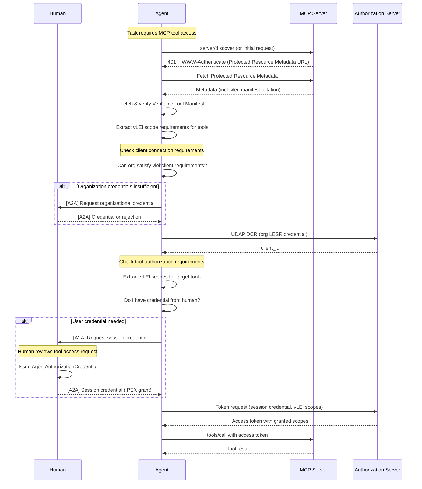

# MCP Tool Discovery and Authorization for Agents

## Enabling autonomous agents to discover, authenticate, and access MCP tools on behalf of humans using vLEI credentials

**Status:** Draft v0.1 — for discussion
**Date:** 27 October 2026
**Intended audience:** VITAL Initiative participants; implementers of AI agents, MCP servers, MCP clients, vLEI credential systems, and UDAP authorization servers
**Relationship to other documents:**
- Complements [`API_Discovery_and_Authorization_for_Agents.md`](API_Discovery_and_Authorization_for_Agents.md) — this specification applies the same patterns to MCP tool access.
- Extends [`Verifiable_Dossier_for_API_Services.md`](Verifiable_Dossier_for_API_Services.md) with MCP tool manifest verifiability.
- Uses the UDAP vLEI profiles defined in [`udap-vlei-dynamic-client-registration.html`](udap-vlei-dynamic-client-registration.html) and [`udap-vlei-acdc-client-auth.html`](udap-vlei-acdc-client-auth.html).
- Integrates with the [A2A Protocol](https://github.com/a2aproject/a2a) for credential requirement propagation.
- Aligns with the [MCP 2026-07-28 Specification](https://modelcontextprotocol.io/specification/2026-07-28/basic/authorization) for authorization flows.

---

## 1. Abstract

The Model Context Protocol (MCP) enables AI agents to discover and invoke tools exposed by MCP servers. In regulated domains, these tools require verifiable organizational identity and role-based authorization through vLEI credentials. This specification defines how an autonomous agent can:

1. **Discover** available MCP tools and their credential requirements from a Verifiable Tool Manifest
2. **Evaluate** whether its organization holds the credentials needed for client registration
3. **Request** from its supervising human the credentials needed for tool-level authorization
4. **Register** as an MCP client using UDAP vLEI Dynamic Client Registration
5. **Authenticate** at the token endpoint using vLEI-backed scopes
6. **Propagate** credential requirements through agent chains via the A2A protocol

This specification extends MCP's existing OAuth 2.1 authorization with vLEI credential requirements, defining new vLEI-specific scopes that map tool operations to verifiable credentials.

---

## 2. Conventions and Terminology

The key words **MUST**, **MUST NOT**, **REQUIRED**, **SHALL**, **SHALL NOT**, **SHOULD**, **SHOULD NOT**, **RECOMMENDED**, **MAY** and **OPTIONAL** are interpreted as described in RFC 2119 and RFC 8174 when, and only when, they appear in all capitals.

| Term | Definition |
|---|---|
| **A2A** | Agent-to-Agent Protocol. An open standard for inter-agent communication using JSON-RPC over HTTP. |
| **Agent** | An autonomous software system with its own KERI AID that can discover MCP tools, request credentials, and make authenticated tool invocations. |
| **Client Connection** | The set of organizational credentials needed to register as an MCP client and obtain any access token. |
| **Human Above the Loop** | The human who supervises an agent, holds authoritative vLEI credentials, and can issue credentials to authorize agent actions. |
| **MCP** | Model Context Protocol. An open standard for connecting AI agents to tools, data sources, and prompt templates. |
| **MCP Client** | An agent or host application that connects to MCP servers to invoke tools. |
| **MCP Server** | A service that exposes tools, resources, and prompts via the MCP protocol. |
| **Protected Resource Metadata** | OAuth 2.0 metadata document (RFC 9728) that describes an MCP server's authorization requirements. |
| **Session Credential** | A short-lived ACDC credential issued by a human to an agent for the duration of a task or session. |
| **Tool Manifest** | MCP's description of available tools, their schemas, and capabilities. |
| **Verifiable Tool Manifest** | An ACDC that wraps the MCP tool manifest, providing cryptographic verifiability of tool definitions and their credential requirements. |
| **vLEI Scope** | An OAuth scope prefixed with `vlei:` that maps to a vLEI credential requirement. |

---

## 3. Overview

### 3.1 MCP Authorization Context

MCP's [2026-07-28 specification](https://modelcontextprotocol.io/specification/2026-07-28/basic/authorization) defines OAuth 2.1-based authorization:

1. MCP servers publish Protected Resource Metadata at `/.well-known/oauth-protected-resource`
2. Clients discover authorization servers via this metadata
3. Clients register and obtain tokens with scopes like `tools.execute`, `resources.read`
4. Tokens are presented in the `Authorization` header for all MCP requests

This specification extends this model with:
- **Verifiable Tool Manifests** that cryptographically bind tool definitions to a vLEI-identified organization
- **vLEI-specific scopes** that map MCP operations to credential requirements
- **UDAP vLEI integration** for client registration and authentication

### 3.2 Agent Identity Model

The agent identity model is identical to the API specification:

```
┌─────────────────────────────────────────────────────────────────────┐
│                     HUMAN ABOVE THE LOOP                            │
│                                                                     │
│  ┌──────────────┐     holds      ┌────────────────────────────────┐│
│  │  Human AID   │◄──────────────►│  ECR vLEI Credential           ││
│  │              │                │  (Tool Operator, etc.)         ││
│  └──────────────┘                └────────────────────────────────┘│
│         │                                                           │
│         │ issues (for session)                                      │
│         ▼                                                           │
│  ┌──────────────────────────────────────────────────────────────┐  │
│  │              SESSION AGENT CREDENTIAL                         │  │
│  │  Schema: AgentAuthorizationCredential                         │  │
│  │  Issuee: Agent AID                                            │  │
│  │  Chains to: Human's ECR credential                            │  │
│  │  Attributes: scope (vLEI scopes), expiration, tool constraints│  │
│  └──────────────────────────────────────────────────────────────┘  │
└─────────────────────────────────────────────────────────────────────┘
         │
         │ presented by
         ▼
┌─────────────────────────────────────────────────────────────────────┐
│                          AGENT                                       │
│                                                                      │
│  ┌──────────────┐                  ┌─────────────────────────┐      │
│  │  Agent AID   │                  │  Organization's LESR    │      │
│  │  (independent│◄─────────────────│  (via agent binding)    │      │
│  │   identity)  │                  │                         │      │
│  └──────────────┘                  └─────────────────────────┘      │
└─────────────────────────────────────────────────────────────────────┘
```

### 3.3 Two-Phase Authorization Model

| Phase | Purpose | Credential Source | OAuth Flow |
|---|---|---|---|
| **Client Connection** | Establish the agent's organization as an authorized MCP client | Organization's LESR credential | UDAP vLEI Dynamic Client Registration |
| **Tool Authorization** | Authorize the agent to invoke specific tools on behalf of a human | Session credential issued by the human | Token request with vLEI scopes |

### 3.4 End-to-End Flow



---

## 4. Verifiable Tool Manifest

### 4.1 Purpose

The Verifiable Tool Manifest is an ACDC that wraps the MCP server's tool manifest, providing:

1. **Provenance**: Cryptographic proof that tools are published by a vLEI-identified organization
2. **Integrity**: SAID-based verification that tool definitions haven't been altered
3. **Credential Requirements**: vLEI scope mappings for each tool

### 4.2 Integration with MCP Discovery

The Verifiable Tool Manifest is discovered through MCP's Protected Resource Metadata:

```json
{
  "resource": "https://mcp.example.com",
  "authorization_servers": ["https://auth.example.com"],
  "scopes_supported": [
    "tools.execute",
    "vlei:client:care-coordinator",
    "vlei:tool:patient-export:data-exchange-rep"
  ],
  "vlei": {
    "manifest_citation": "https://mcp.example.com/.well-known/vlei/tool-manifest",
    "holder_oobi": "https://mcp.example.com/oobi/EMcpServerAid.../witness",
    "dossier_citation": "https://example.com/.well-known/vlei/dossier"
  }
}
```

The `vlei` extension in Protected Resource Metadata:

| Field | Required | Description |
|---|---|---|
| `manifest_citation` | REQUIRED | URL returning the Verifiable Tool Manifest as `application/cesr` |
| `holder_oobi` | REQUIRED | OOBI for resolving the MCP server operator's AID |
| `dossier_citation` | OPTIONAL | Link to the organization's API Service Dossier (if MCP server is part of a larger API offering) |

### 4.3 Verifiable Tool Manifest Schema

The Verifiable Tool Manifest wraps the standard MCP tool listing with vLEI credential requirements:

```json
{
  "$schema": "https://json-schema.org/draft/2020-12/schema",
  "$id": "<Verifiable Tool Manifest schema SAID>",
  "title": "Verifiable Tool Manifest",
  "description": "ACDC wrapping an MCP tool manifest with vLEI credential requirements.",
  "credentialType": "VerifiableToolManifest",
  "version": "1.0.0",
  "type": "object",
  "required": ["v", "d", "i", "s", "a", "e"],
  "properties": {
    "a": {
      "type": "object",
      "required": ["d", "dt", "serverUri", "protocolVersion"],
      "properties": {
        "d": { "type": "string" },
        "dt": { "type": "string", "format": "date-time" },
        "serverUri": {
          "type": "string",
          "format": "uri",
          "description": "Canonical MCP server URI (resource identifier)"
        },
        "protocolVersion": {
          "type": "string",
          "description": "MCP protocol version (e.g., '2026-07-28')"
        },
        "serverName": { "type": "string" },
        "serverDescription": { "type": "string" }
      }
    },
    "e": {
      "type": "object",
      "required": ["d", "authority", "tools"],
      "properties": {
        "authority": {
          "type": "object",
          "description": "Edge to the operator's vLEI credential",
          "required": ["n", "s", "o"],
          "properties": {
            "n": { "type": "string" },
            "s": { "type": "string" },
            "o": { "const": "I2I" }
          }
        },
        "tools": {
          "type": "object",
          "description": "Edge group containing wrapped tool definitions",
          "additionalProperties": {
            "$ref": "#/$defs/toolEdge"
          }
        },
        "clientConnection": {
          "type": "object",
          "description": "Edge to credential requirements for client registration",
          "$ref": "#/$defs/credentialRequirementEdge"
        }
      }
    }
  },
  "$defs": {
    "toolEdge": {
      "type": "object",
      "required": ["n", "s"],
      "properties": {
        "n": { "type": "string", "description": "SAID of ToolDefinitionWrapper" },
        "s": { "type": "string", "description": "Schema SAID" }
      }
    },
    "credentialRequirementEdge": {
      "type": "object",
      "required": ["n", "s"],
      "properties": {
        "n": { "type": "string" },
        "s": { "type": "string" }
      }
    }
  }
}
```

### 4.4 Tool Definition Wrapper

Each tool is wrapped in an artifact wrapper ACDC that binds the MCP tool definition to its vLEI requirements:

```json
{
  "v": "ACDC10JSON...",
  "d": "EToolDefWrapper...",
  "i": "EMcpServerAid...",
  "s": "<Tool Definition Wrapper schema SAID>",
  "a": {
    "d": "EAttrs...",
    "dt": "2026-10-27T10:00:00Z",
    "toolName": "export_patient_data",
    "toolDescription": "Export patient data for attributed members",
    "inputSchema": {
      "type": "object",
      "properties": {
        "groupId": { "type": "string" },
        "format": { "enum": ["ndjson", "fhir-bundle"] }
      },
      "required": ["groupId"]
    },
    "vleiScopes": {
      "execute": ["vlei:tool:patient-export:data-exchange-rep"],
      "read": ["vlei:tool:patient-export:care-coordinator"]
    },
    "contentDigest": {
      "algorithm": "blake3-256",
      "value": "<digest of canonical tool definition>"
    }
  }
}
```

### 4.5 Example Verifiable Tool Manifest

```json
{
  "v": "ACDC10JSON...",
  "d": "EToolManifest...",
  "i": "EMcpServerAid...",
  "ri": "EMcpServerRegistry...",
  "s": "<Verifiable Tool Manifest schema SAID>",
  "a": {
    "d": "EAttrs...",
    "dt": "2026-10-27T10:00:00Z",
    "serverUri": "https://mcp.examplehealth.com",
    "protocolVersion": "2026-07-28",
    "serverName": "Example Health MCP Tools",
    "serverDescription": "Healthcare data tools for Provider Access API"
  },
  "e": {
    "d": "EEdges...",
    "authority": {
      "n": "EExampleHealthLECred...",
      "s": "ENPXp1vQzRF6JwIuS-mp2U8Uf1MoADoP_GqQ62VsDZWY",
      "o": "I2I"
    },
    "clientConnection": {
      "n": "EClientConnReq...",
      "s": "<Credential Requirement schema SAID>"
    },
    "tools": {
      "d": "EToolsGroup...",
      "export_patient_data": {
        "n": "EExportPatientToolDef...",
        "s": "<Tool Definition Wrapper schema SAID>"
      },
      "search_groups": {
        "n": "ESearchGroupsToolDef...",
        "s": "<Tool Definition Wrapper schema SAID>"
      },
      "get_member_attribution": {
        "n": "EGetMemberAttrToolDef...",
        "s": "<Tool Definition Wrapper schema SAID>"
      }
    }
  }
}
```

---

## 5. vLEI Scope Extensions

### 5.1 Scope Syntax

This specification defines vLEI-specific OAuth scopes using the `vlei:` prefix:

```
vlei:<category>:<resource>:<role>
```

| Component | Description | Examples |
|---|---|---|
| `vlei:` | Prefix identifying vLEI credential-backed scopes | — |
| `<category>` | Scope category | `client`, `tool`, `resource` |
| `<resource>` | Target resource (tool name, resource type) | `patient-export`, `member-match`, `*` |
| `<role>` | Required vLEI role (maps to credential) | `care-coordinator`, `data-exchange-rep` |

### 5.2 Scope Categories

| Category | Purpose | Example |
|---|---|---|
| `vlei:client:*` | Client connection (registration) requirements | `vlei:client:care-coordinator` |
| `vlei:tool:<name>:*` | Tool-specific execution requirements | `vlei:tool:patient-export:data-exchange-rep` |
| `vlei:resource:<type>:*` | MCP resource access requirements | `vlei:resource:patient:read` |

### 5.3 Scope-to-Credential Mapping

The authorization server maintains a mapping from vLEI scopes to credential requirements:

```json
{
  "vlei:client:care-coordinator": {
    "schema": "EHfJ563sbivepFRzk506fJenWIeVG2uXdAes8iJhHJan",
    "schemaName": "Legal Entity Subunit Role vLEI Credential",
    "attributes": {
      "policyDomain": { "const": "ONC" },
      "endorsementCode": { "const": "T-HCO-CC" }
    },
    "holder": ["issuee", "agent"],
    "subject": "client"
  },
  "vlei:tool:patient-export:data-exchange-rep": {
    "schema": "EEy9PkikFcANV1l7EHukCeXqrzT1hNZjGlUk7wuMO5jw",
    "schemaName": "Engagement Context Role vLEI Credential",
    "attributes": {
      "engagementContextRole": { "const": "Data Exchange Representative" }
    },
    "holder": ["issuee"],
    "subject": "user"
  }
}
```

### 5.4 Scope Discovery

vLEI scopes are advertised in multiple locations:

1. **Protected Resource Metadata** (`scopes_supported`):
   ```json
   {
     "scopes_supported": [
       "tools.execute",
       "vlei:client:care-coordinator",
       "vlei:tool:patient-export:data-exchange-rep",
       "vlei:tool:search-groups:care-coordinator"
     ]
   }
   ```

2. **WWW-Authenticate Challenge**:
   ```http
   HTTP/1.1 401 Unauthorized
   WWW-Authenticate: Bearer resource_metadata="https://mcp.example.com/.well-known/oauth-protected-resource",
                            scope="vlei:client:care-coordinator"
   ```

3. **Tool Definition Wrapper** (`vleiScopes`):
   ```json
   {
     "vleiScopes": {
       "execute": ["vlei:tool:patient-export:data-exchange-rep"],
       "read": ["vlei:tool:patient-export:care-coordinator"]
     }
   }
   ```

### 5.5 Scope Hierarchy

vLEI scopes support hierarchical matching:

| Requested Scope | Satisfied By |
|---|---|
| `vlei:tool:patient-export:data-exchange-rep` | Exact match only |
| `vlei:tool:*:data-exchange-rep` | Any tool with `data-exchange-rep` role |
| `vlei:*:*:care-coordinator` | Any category/resource with `care-coordinator` role |

Authorization servers **MAY** support wildcard scopes for broader grants, but **SHOULD** prefer specific scopes for audit clarity.

---

## 6. Client Connection (Phase 1)

### 6.1 Overview

Client connection establishes the agent's organization as an authorized MCP client. This follows the same model as the API specification.

### 6.2 MCP Authorization Server Requirements

MCP authorization servers supporting vLEI credentials **MUST**:

1. Support UDAP vLEI Dynamic Client Registration
2. Implement the scope-to-credential mapping (§5.3)
3. Validate vLEI credential chains during registration and token requests
4. Include `vlei` in their authorization server metadata:

```json
{
  "issuer": "https://auth.example.com",
  "authorization_endpoint": "https://auth.example.com/authorize",
  "token_endpoint": "https://auth.example.com/token",
  "registration_endpoint": "https://auth.example.com/register",
  "vlei": {
    "supported": true,
    "scope_mapping_endpoint": "https://auth.example.com/.well-known/vlei/scope-mapping",
    "trusted_roots": [
      "EDP1vHC3rVPT-WQxOjnD2VPqh_0V_Lq1x0ltICzERrUs"
    ]
  }
}
```

### 6.3 Registration Flow

Per UDAP vLEI DCR:

```http
POST /register HTTP/1.1
Host: auth.example.com
Content-Type: application/json

{
  "software_statement_type": "urn:ietf:params:oauth:client-assertion-type:acdc-vlei",
  "software_statement": "<CESR: Agent Role → LESR → chain to root>",
  "udap": "1",
  "grant_types": ["client_credentials"],
  "scope": "tools.execute vlei:client:care-coordinator"
}
```

**Success Response:**
```json
{
  "client_id": "mcp-agent-client-xyz",
  "software_statement_type": "urn:ietf:params:oauth:client-assertion-type:acdc-vlei",
  "token_endpoint_auth_method": "acdc_vlei",
  "grant_types": ["client_credentials"],
  "scope": "tools.execute vlei:client:care-coordinator"
}
```

---

## 7. Tool Authorization (Phase 2)

### 7.1 Overview

Tool authorization grants the agent access to specific tools that require human authority. This maps to vLEI scopes with `subject: "user"`.

### 7.2 Session Credential for MCP

The Agent Authorization Credential (defined in the API spec) is extended for MCP tool access:

```json
{
  "v": "ACDC10JSON...",
  "d": "EAgentAuthCred...",
  "i": "EHumanAid...",
  "s": "<Agent Authorization Credential schema SAID>",
  "a": {
    "d": "EAttrs...",
    "i": "EAgentAid...",
    "dt": "2026-10-27T10:00:00Z",
    "purpose": "Export patient data via MCP tools",
    "scope": [
      "vlei:tool:patient-export:data-exchange-rep",
      "vlei:tool:member-match:data-exchange-rep"
    ],
    "mcpConstraints": [{
      "manifestSaid": "EToolManifest...",
      "serverUri": "https://mcp.examplehealth.com",
      "tools": ["export_patient_data", "get_member_attribution"]
    }],
    "expiration": "2026-10-27T12:00:00Z"
  },
  "e": {
    "d": "EEdges...",
    "authority": {
      "n": "EHumanECR...",
      "s": "EEy9PkikFcANV1l7EHukCeXqrzT1hNZjGlUk7wuMO5jw",
      "o": "I2I"
    }
  }
}
```

### 7.3 Token Request with vLEI Scopes

```http
POST /token HTTP/1.1
Host: auth.example.com
Content-Type: application/x-www-form-urlencoded

grant_type=client_credentials&
client_id=mcp-agent-client-xyz&
scope=tools.execute vlei:tool:patient-export:data-exchange-rep&
resource=https://mcp.examplehealth.com&
client_assertion_type=urn:ietf:params:oauth:client-assertion-type:acdc-vlei&
client_assertion=<CESR: IPEX Grant with session credential → ECR → chain>
```

**Response:**
```json
{
  "access_token": "eyJ...",
  "token_type": "Bearer",
  "expires_in": 3600,
  "scope": "tools.execute vlei:tool:patient-export:data-exchange-rep",
  "vlei": {
    "aid": "EAgentAid...",
    "humanAid": "EHumanAid...",
    "grantedScopes": ["vlei:tool:patient-export:data-exchange-rep"]
  }
}
```

### 7.4 Tool Invocation

With a valid token, the agent invokes tools:

```http
POST /mcp HTTP/1.1
Host: mcp.examplehealth.com
Authorization: Bearer eyJ...
Mcp-Method: tools/call
Mcp-Name: export_patient_data
Content-Type: application/json

{
  "jsonrpc": "2.0",
  "id": "req-123",
  "method": "tools/call",
  "params": {
    "name": "export_patient_data",
    "arguments": {
      "groupId": "group-aetna-001",
      "format": "ndjson"
    }
  },
  "_meta": {
    "protocolVersion": "2026-07-28",
    "clientCapabilities": {}
  }
}
```

### 7.5 Insufficient Scope Handling

If the agent's token lacks required vLEI scopes:

```http
HTTP/1.1 403 Forbidden
WWW-Authenticate: Bearer error="insufficient_scope",
                         scope="vlei:tool:patient-export:data-exchange-rep",
                         resource_metadata="https://mcp.examplehealth.com/.well-known/oauth-protected-resource",
                         error_description="Data Exchange Representative credential required for patient export"
```

The agent then follows the step-up authorization flow (§8 A2A integration).

---

## 8. Agent Bootstrapping

Agent bootstrapping follows the same process as the API specification:

1. **Create an AID**: The agent generates its own KERI identifier
2. **Publish OOBI**: The agent makes its AID discoverable
3. **Obtain Organizational Binding**: The organization issues a Legal Entity Subunit Agent Role credential
4. **Configure Trust Anchors**: The agent is configured with trusted root AIDs

For MCP access, the agent additionally:
5. **Caches Verifiable Tool Manifests**: From MCP servers it commonly uses
6. **Maintains Scope Mappings**: Understanding which credentials satisfy which vLEI scopes

---

## 9. A2A Protocol Integration

### 9.1 MCP Tool Credential Requirement Artifact

When an agent discovers it needs credentials for MCP tool access, it uses an MCP-specific artifact format:

```json
{
  "artifactId": "mcp-cred-req-<uuid>",
  "name": "MCP Tool Credential Requirement",
  "parts": [{
    "mimeType": "application/vnd.vital.mcp-credential-requirement+json",
    "data": {
      "version": "1.0",
      "type": "tool-authorization",
      "mcpServer": {
        "serverUri": "https://mcp.examplehealth.com",
        "serverName": "Example Health MCP Tools",
        "manifestSaid": "EToolManifest...",
        "manifestCitation": "https://mcp.examplehealth.com/.well-known/vlei/tool-manifest"
      },
      "tool": {
        "name": "export_patient_data",
        "description": "Export patient data for attributed members",
        "vleiScopes": ["vlei:tool:patient-export:data-exchange-rep"]
      },
      "requirement": {
        "schema": "EEy9PkikFcANV1l7EHukCeXqrzT1hNZjGlUk7wuMO5jw",
        "schemaOobi": "https://schema.gleif.org/oobi/EEy9PkikFcANV1l7EHukCeXqrzT1hNZjGlUk7wuMO5jw",
        "schemaName": "Engagement Context Role vLEI Credential",
        "attributes": {
          "engagementContextRole": {
            "const": "Data Exchange Representative"
          }
        },
        "holder": ["issuee"]
      },
      "humanReadable": {
        "title": "Data Exchange Representative Authorization Required",
        "description": "To use the 'export_patient_data' tool on Example Health's MCP server, you must authorize this agent to act as your Data Exchange Representative.",
        "actionRequired": "Please issue an Agent Authorization Credential with scope 'vlei:tool:patient-export:data-exchange-rep'."
      },
      "agentInfo": {
        "agentAid": "EAgentAid...",
        "agentOobi": "https://agent.example/oobi/EAgentAid.../witness",
        "sessionId": "task-<uuid>",
        "requestedScopes": ["vlei:tool:patient-export:data-exchange-rep"],
        "requestedExpiration": "2026-10-28T00:00:00Z"
      }
    }
  }]
}
```

### 9.2 Task State: AUTH_REQUIRED

When an agent needs MCP tool credentials:

```json
{
  "jsonrpc": "2.0",
  "method": "tasks/send",
  "params": {
    "taskId": "task-<uuid>",
    "message": {
      "role": "agent",
      "parts": [{
        "mimeType": "text/plain",
        "text": "I need authorization to use the 'export_patient_data' tool on Example Health's MCP server."
      }]
    },
    "artifacts": [{
      "artifactId": "mcp-cred-req-<uuid>",
      "name": "MCP Tool Credential Requirement",
      "parts": [{ "...": "as above" }]
    }],
    "state": "auth_required"
  }
}
```

### 9.3 Sub-Agent Tool Access

Sub-agents requiring MCP tool access follow the same pattern as the API specification:

1. The sub-agent discovers tool requirements from the Verifiable Tool Manifest
2. The sub-agent requests credentials via A2A from the primary agent
3. The primary agent forwards the request to the human
4. The human issues credentials directly to the sub-agent's AID

---

## 10. Credential Revocation

### 10.1 Revocation Scenarios

| Scenario | Effect on MCP Access |
|---|---|
| Session credential revoked | Agent cannot obtain new tokens; existing tokens valid until expiry |
| Organizational binding revoked | Agent cannot register or authenticate |
| Human's underlying credential revoked | All session credentials chaining to it become invalid |
| Tool removed from manifest | New manifest version published; existing tokens may still work |

### 10.2 Manifest Versioning

When tools change:

1. The MCP server issues a new Verifiable Tool Manifest
2. The previous manifest is revoked in its TEL
3. Agents **SHOULD** re-verify the manifest periodically
4. Protected Resource Metadata **MAY** include `manifest_version` for change detection

### 10.3 Token Revocation and Tool Changes

If a tool's credential requirements change:

1. Existing tokens with old scopes remain valid until expiry
2. New tokens require updated credentials
3. MCP servers **MAY** reject old tokens for security-sensitive tool changes

---

## 11. Audit Trail

### 11.1 Token Claims for MCP Audit

Access tokens **SHOULD** include:

```json
{
  "vlei": {
    "aid": "EAgentAid...",
    "humanAid": "EHumanAid...",
    "lei": "254900ABCDEFG1234567",
    "grantedScopes": ["vlei:tool:patient-export:data-exchange-rep"],
    "credentials": ["EAgentAuthCred...", "EHumanECR..."],
    "sessionPurpose": "Export patient data via MCP tools",
    "manifestSaid": "EToolManifest..."
  }
}
```

### 11.2 MCP Server Logging

MCP servers **SHOULD** log:

1. Tool name and arguments (redacted as appropriate)
2. The `vlei` claims from the access token
3. Tool execution result (success/failure)
4. Timestamp and request correlation ID

### 11.3 Correlation with API Access

When MCP tools invoke underlying APIs:

1. The MCP server **SHOULD** propagate the agent's AID
2. API servers **SHOULD** correlate MCP tool calls with direct API access
3. Audit trails **SHOULD** link: Human → Agent → MCP Tool → API Call

---

## 12. Security Considerations

### 12.1 Tool Manifest Trust

Agents **MUST**:
- Verify the Verifiable Tool Manifest's signature chain
- Confirm the manifest issuer's AID chains to a trusted root
- Check manifest revocation status via TEL

Agents **MUST NOT**:
- Trust unverified tool definitions
- Use tools from manifests with broken chains

### 12.2 Scope Minimization

Per MCP best practices, agents **SHOULD**:
- Request only scopes needed for the current task
- Use `mcpConstraints` to limit credential scope to specific tools
- Prefer short-lived session credentials

### 12.3 Tool Input Validation

MCP tools may accept sensitive data as input. Agents **SHOULD**:
- Only invoke tools authorized by the human's session credential
- Redact sensitive data from A2A task artifacts when appropriate
- Log tool inputs for audit (with appropriate redaction)

### 12.4 Cross-Organization Considerations

This specification assumes the MCP server is operated by the same organization as the API provider. Future extensions may address:
- Cross-organization tool invocation
- Federated tool manifests
- Multi-party credential chains

---

## 13. Implementation Notes

### 13.1 MCP Client Library Integration

MCP client libraries **SHOULD** be extended to:

1. Parse `vlei` extensions from Protected Resource Metadata
2. Fetch and verify Verifiable Tool Manifests
3. Extract vLEI scope requirements from tool definitions
4. Support UDAP vLEI DCR and client authentication

### 13.2 Caching Strategy

Agents **SHOULD** cache:
- Verified Tool Manifests (keyed by SAID, with TEL status checks)
- Scope-to-credential mappings
- Client registrations per MCP server
- Session credentials (until expiration)

### 13.3 Parallel Tool Access

An agent may register with multiple MCP servers concurrently if:
- Each server has its own Verifiable Tool Manifest
- The agent's organizational credentials satisfy each server's requirements

### 13.4 Integration with API Access

When an agent needs both API and MCP tool access from the same organization:

1. Use the same organizational credentials for both DCR flows
2. Session credentials **MAY** include both API roles and MCP tool scopes
3. The API Service Dossier **MAY** reference the Verifiable Tool Manifest

---

## 14. References

- [API Discovery and Authorization for Agents](API_Discovery_and_Authorization_for_Agents.md)
- [Verifiable Dossier for API Services](Verifiable_Dossier_for_API_Services.md)
- [UDAP vLEI Dynamic Client Registration](udap-vlei-dynamic-client-registration.html)
- [UDAP vLEI ACDC Client Authentication](udap-vlei-acdc-client-auth.html)
- [MCP 2026-07-28 Specification](https://modelcontextprotocol.io/specification/2026-07-28/basic/authorization)
- [MCP Authorization Deep Dive](https://www.descope.com/blog/post/mcp-auth-spec)
- [A2A Protocol](https://github.com/a2aproject/a2a)
- [A2A Protocol Technical Overview](https://tyk.io/learning-center/a2a-protocol-architecture-and-technical-specification/)
- KERI Specification
- ACDC Specification

---

## Appendix A. MCP Tool Credential Requirement Artifact JSON Schema

```json
{
  "$schema": "https://json-schema.org/draft/2020-12/schema",
  "$id": "https://vital.example/schema/a2a/mcp-credential-requirement/1.0",
  "title": "A2A MCP Tool Credential Requirement Artifact",
  "type": "object",
  "required": ["version", "type", "mcpServer", "tool", "requirement", "humanReadable", "agentInfo"],
  "properties": {
    "version": { "const": "1.0" },
    "type": {
      "enum": ["client-connection", "tool-authorization"],
      "description": "Whether this is for DCR or tool-level auth"
    },
    "mcpServer": {
      "type": "object",
      "required": ["serverUri", "manifestSaid"],
      "properties": {
        "serverUri": { "type": "string", "format": "uri" },
        "serverName": { "type": "string" },
        "manifestSaid": { "type": "string" },
        "manifestCitation": { "type": "string", "format": "uri" }
      }
    },
    "tool": {
      "type": "object",
      "required": ["name", "vleiScopes"],
      "properties": {
        "name": { "type": "string" },
        "description": { "type": "string" },
        "vleiScopes": {
          "type": "array",
          "items": { "type": "string", "pattern": "^vlei:" }
        }
      }
    },
    "requirement": {
      "type": "object",
      "required": ["schema"],
      "properties": {
        "schema": { "type": "string" },
        "schemaOobi": { "type": "string", "format": "uri" },
        "schemaName": { "type": "string" },
        "attributes": { "type": "object" },
        "holder": {
          "type": "array",
          "items": { "enum": ["issuee", "agent", "delegate"] }
        }
      }
    },
    "humanReadable": {
      "type": "object",
      "required": ["title", "description", "actionRequired"],
      "properties": {
        "title": { "type": "string" },
        "description": { "type": "string" },
        "actionRequired": { "type": "string" }
      }
    },
    "agentInfo": {
      "type": "object",
      "required": ["agentAid", "agentOobi"],
      "properties": {
        "agentAid": { "type": "string" },
        "agentOobi": { "type": "string", "format": "uri" },
        "sessionId": { "type": "string" },
        "requestedScopes": { "type": "array", "items": { "type": "string" } },
        "requestedExpiration": { "type": "string", "format": "date-time" }
      }
    }
  }
}
```

---

## Appendix B. vLEI Scope Examples

| vLEI Scope | Required Credential | Attributes |
|---|---|---|
| `vlei:client:care-coordinator` | LESR | `policyDomain: ONC`, `endorsementCode: T-HCO-CC` |
| `vlei:client:payer` | LESR | `policyDomain: CMS`, `endorsementCode: T-PAY` |
| `vlei:tool:patient-export:data-exchange-rep` | ECR | `engagementContextRole: Data Exchange Representative` |
| `vlei:tool:member-match:care-coordinator` | LESR or ECR | `endorsementCode: T-HCO-CC` or equivalent role |
| `vlei:resource:patient:read` | ECR | Any clinical role |
| `vlei:resource:coverage:write` | ECR | `engagementContextRole: Benefits Administrator` |

---

## Appendix C. Relationship to API Service Dossier

When an organization offers both APIs and MCP tools, the API Service Dossier **MAY** reference the Verifiable Tool Manifest:

```json
{
  "e": {
    "...": "other edges",
    "mcpTools": {
      "d": "EMcpToolsGroup...",
      "providerAccess": {
        "n": "EToolManifest...",
        "s": "<Verifiable Tool Manifest schema SAID>"
      }
    }
  }
}
```

This allows discovery of MCP tools through the API Service Dossier, providing a unified entry point for both API and MCP access.
