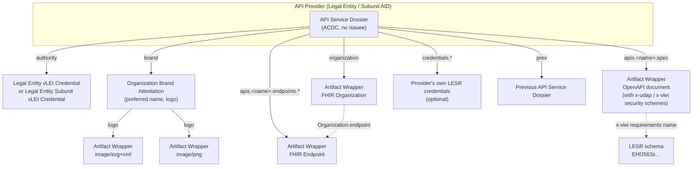

# Verifiable Dossier for API Services

## Publishing verifiable organization identity, endpoints, API specifications and vLEI-based UDAP security requirements

**Status:** Draft v0.1 — for discussion
**Date:** 22 October 2026
**Intended audience:** VITAL Initiative participants; implementers of UDAP / FAST Security authorization servers, FHIR API publishers, and vLEI credential issuers and verifiers
**Relationship to other documents:**
- Profiles the [ToIP KSWG Verifiable Dossier Specification](https://trustoverip.github.io/kswg-dossier-specification/) for API service discovery.
- Reuses the Organization / Endpoint pattern of the [HL7 APIX Organization & Endpoint guidance](https://build.fhir.org/ig/HL7/APIX---API-Exchange-for-Medicinal-Products/en/apixorganizationEndpoint.html).
- Builds on the VITAL credential hierarchy in [`Credential-Hierarchy-Graph.md`](Credential-Hierarchy-Graph.md) and the schemas in [`../schema`](../schema), in particular the Legal Entity Subunit Role (LESR) vLEI Credential.
- Complements [`UDAP_vLEI_Onboarding_Intake_Design.md`](UDAP_vLEI_Onboarding_Intake_Design.md). That document covers how a requester gets onto an allow list. This document covers how a responder publishes what it offers and what credentials it needs.

---

## 1. Abstract

An organization that exposes APIs to trading partners needs to publish four things, and today it publishes each of them through a different, unauthenticated channel:

1. **Who it is.** Legal identity, preferred display name and logo.
2. **Where its services are.** Endpoints, as FHIR `Organization` and `Endpoint` resources.
3. **What its services do.** API specifications, such as OpenAPI documents or FHIR CapabilityStatements.
4. **What a caller must prove to use them.** Security schemes and the credentials each scheme requires.

This specification puts all four into a single **API Service Dossier**. The dossier is a Verifiable Dossier: an ACDC that the organization's vLEI-identified AID issues and anchors in its KEL. Each component is bound into the dossier by SAID, so a consumer can verify the following from one artifact, either online or offline:

- that the logo, name, endpoints and API specifications were published by the legal entity identified by a specific LEI;
- that none of them has been altered since publication; and
- which vLEI credentials, and specifically which **Legal Entity Subunit Role (LESR) vLEI credentials**, are needed to connect to each API and to call each operation.

The specification also defines **vLEI and UDAP extensions to the OpenAPI `oauth2` Security Scheme Object**. With these extensions a security scheme can declare:

- the LESR credentials needed to establish a client connection (registration and token issuance); and
- named **roles**, each backed by its own credential requirements, that individual operations or the whole API can require through ordinary OpenAPI Security Requirement Objects.

---

## 2. Conventions and terminology

The key words **MUST**, **MUST NOT**, **REQUIRED**, **SHALL**, **SHALL NOT**, **SHOULD**, **SHOULD NOT**, **RECOMMENDED**, **MAY** and **OPTIONAL** are interpreted as described in RFC 2119 and RFC 8174 when, and only when, they appear in all capitals.

| Term | Definition |
|---|---|
| **ACDC** | Authentic Chained Data Container. A verifiable data structure whose identifier is a SAID and whose provenance is anchored in a KERI KEL or TEL. |
| **AID** | KERI Autonomic Identifier. |
| **API Service Dossier** | The Verifiable Dossier defined by this specification (§4). |
| **API Provider** | The legal entity, or legal entity subunit, that operates the APIs and issues the API Service Dossier. |
| **API Consumer** | A client organization, and its software, that calls the API Provider's APIs. |
| **Artifact Wrapper** | A *foreign artifact wrapper* as defined by the Dossier Specification. It is a no-issuee ACDC that gives a non-ACDC artifact (a logo, FHIR resource or OpenAPI document) a cryptographic identity through `content_digest` and `content_type`. |
| **Citation** | A resolvable identifier, usually an OOBI URL, that returns the dossier and its reachable evidence as an `application/cesr` stream. |
| **Client Connection Requirement** | The set of credential requirements that an API Consumer MUST satisfy before it can register with, and obtain any token from, the authorization server behind a security scheme (§6.2.4). |
| **Credential Requirement** | A machine-readable predicate over a vLEI credential: its schema, attribute constraints, chain and holder binding (§6.3). |
| **Endorsement Code** | The `endorsementCode` attribute of an LESR credential. It names a specific entitlement defined by the `policyDomain`. |
| **LESR** | Legal Entity Subunit Role vLEI Credential, schema SAID `EHfJ563sbivepFRzk506fJenWIeVG2uXdAes8iJhHJan`. |
| **Policy Domain** | The certifying authority whose rules determine endorsements (the LESR `policyDomain` attribute). |
| **Role** | A named, credential-backed entitlement declared within a security scheme and referenced from Security Requirement Objects (§6.2.5, §7). |
| **SAID** | Self-Addressing IDentifier. A cryptographic digest embedded in the content it identifies. |
| **UDAP** | Unified Data Access Profiles, as profiled by the HL7 FAST Security IG. |

---

## 3. Overview

### 3.1 Architecture



### 3.2 Lifecycle summary

1. **Assemble.** The API Provider builds its FHIR `Organization` and `Endpoint` resources, its logo files and its OpenAPI documents. The OpenAPI security schemes carry the `x-udap` and `x-vlei` extensions.
2. **Wrap.** Each artifact is wrapped in an Artifact Wrapper ACDC that commits to its digest.
3. **Issue.** The API Provider issues an Organization Brand Attestation and then the API Service Dossier, linking every wrapper through edges. The Provider anchors the dossier's SAID in its KEL, or in a TEL anchored by its KEL.
4. **Publish.** The dossier is published at a stable citation location and advertised through UDAP metadata, the FHIR Organization, or both (§8.1).
5. **Consume.** An API Consumer resolves the citation, verifies the dossier (§9) and learns:
   - the endpoints;
   - the API contracts; and
   - the exact LESR and other credentials it must present to register (§6.2.4) and to exercise each role (§6.2.5).
6. **Connect.** The Consumer registers through UDAP Dynamic Client Registration and presents the required vLEI credentials (§8.2). It then requests tokens whose scopes include role names (§8.3).
7. **Call.** The resource server enforces the Security Requirement Objects that apply to each operation (§7).
8. **Revise.** Any change to any component produces a new dossier version that links to its predecessor through `prev` (§10).

---

## 4. The API Service Dossier

### 4.1 General requirements

1. An API Service Dossier **MUST** be a valid Verifiable Dossier as defined by the Dossier Specification.
2. The dossier **MUST NOT** contain an issuee (`a.i`) field.
3. The dossier issuer (`i`) **MUST** be one of:
   - the AID of a Legal Entity that holds a valid Legal Entity vLEI Credential; or
   - the AID of a Legal Entity Subunit that holds a valid Legal Entity Subunit vLEI Credential.
4. The dossier **MUST** be anchored, not signed, according to the Dossier Specification. It **SHOULD** be anchored through a TEL so that it can be revoked explicitly when superseded or withdrawn (§10).
5. All primary evidence **MUST** be bound through the edges block (`e`). The attributes block (`a`) **MUST** carry only proximate metadata (§4.4).

### 4.2 Schema

The API Service Dossier schema **MUST** follow the Dossier Specification's `allOf` construction and reference the base dossier schema by SAID:

```json
{
  "$schema": "https://json-schema.org/draft/2020-12/schema",
  "$id": "<API Service Dossier schema SAID>",
  "title": "API Service Dossier",
  "description": "Verifiable Dossier publishing an organization's identity, brand, FHIR Organization and Endpoint resources, and API specifications with vLEI security requirements.",
  "credentialType": "APIServiceDossier",
  "version": "1.0.0",
  "allOf": [
    {
      "description": "reference to dossier base schema",
      "$ref": "ENroDvI_lXRUa3p1UCxU6Pxp0DWDS1yZNexCq_1TQlcj"
    },
    {
      "type": "object",
      "description": "API Service Dossier constraints",
      "properties": {
        "e": {
          "type": "object",
          "required": ["d", "authority", "brand", "organization", "apis"],
          "additionalProperties": true
        }
      }
    }
  ]
}
```

> **Implementation note.** The Dossier Specification observes that keripy does not yet resolve `$ref`. Until it does, VITAL deployments **MAY** issue the dossier under a flattened schema that inlines the base dossier constraints. Verifiers **MAY** then recognize API Service Dossiers by allowlisting that schema's SAID. The SAIDs of the schemas defined in this document will be generated with the repository's schema tooling (`src/vital/app/cli/commands/schema`) and recorded in [`../schema/README.md`](../schema/README.md).

### 4.3 Schemas defined by this specification

| Schema | Role | SAID |
|---|---|---|
| API Service Dossier | Root of the dossier graph | TBD |
| Organization Brand Attestation | Preferred name and logo (§5.1) | TBD |
| VITAL Artifact Wrapper | Foreign artifact wrapper for logos, FHIR resources and API specifications (§5.2–§5.4) | TBD |

The dossier also references the following existing VITAL and GLEIF schemas:

| Schema | SAID |
|---|---|
| Legal Entity vLEI Credential | `ENPXp1vQzRF6JwIuS-mp2U8Uf1MoADoP_GqQ62VsDZWY` |
| Legal Entity Subunit vLEI Credential | `EP1jGIb7KXotuUZJf1NSu5wQ089epFfv93cpZECj-YBs` |
| LESR Authorization vLEI Credential | `ECoqb1jxC9f9zwh664stMAy6gpnNduvP_3SCQlLvkPAR` |
| Legal Entity Subunit Role (LESR) vLEI Credential | `EHfJ563sbivepFRzk506fJenWIeVG2uXdAes8iJhHJan` |
| Legal Entity Subunit Agent Role vLEI Credential | `EOPrYMoymmZ-MI09YPLtsubNe0gGdpkOoGJ28t5KhMEr` |
| Legal Entity Subunit Role Delegation vLEI Credential | `ELqMgmmATOPHCG8bKVU5M_Nlsc3JkLk6awaMxuOQOZJk` |
| Legal Entity Engagement Context Role (ECR) vLEI Credential | `EEy9PkikFcANV1l7EHukCeXqrzT1hNZjGlUk7wuMO5jw` |

### 4.4 Proximate metadata (`a`)

The attributes block **MUST** contain `d` and `dt`. It **SHOULD** contain the following Dossier Specification proximate-metadata fields:

| Field | Requirement | Value for API Service Dossiers |
|---|---|---|
| `dt` | REQUIRED | Issuance date-time (ISO 8601). |
| `assembly_dt` | RECOMMENDED | The date-time when the components were captured. |
| `purpose` | REQUIRED | The constant `"api-service-discovery"`. |
| `gov` | RECOMMENDED | URI of the governance framework under which the dossier is published, for example the VITAL Ecosystem Governance Framework. |
| `jur` | OPTIONAL | Jurisdiction (ISO 3166), for example `"US"`. |
| `phase` | OPTIONAL | `"production"`, `"sandbox"` or `"test"`. |
| `manifest` | RECOMMENDED | An enumeration of expected components and their status (`provided`, `pending`, `not_applicable`, `withheld`). A `provided` entry **MUST** name an edge that exists in `e`. |
| `attest` | OPTIONAL | Issuer declaration, for example `{"statement": "The endpoints and API specifications referenced by this dossier are operated by the issuer.", "confirmed": true}`. |

The preferred name, logo, LEI and endpoint addresses **MUST NOT** appear in `a`. They are evidence and belong in the edges.

### 4.5 Edges (`e`)

| Edge label | Cardinality | Target | Operator | Purpose |
|---|---|---|---|---|
| `authority` | 1 | Legal Entity vLEI Credential, or Legal Entity Subunit vLEI Credential | `I2I` | Establishes the issuer's verifiable legal identity. The target's issuee **MUST** be the dossier issuer. |
| `brand` | 1 | Organization Brand Attestation (§5.1) | default (`NI2I`) | Preferred name and logo. |
| `organization` | 1 | Artifact Wrapper of a FHIR `Organization` (§5.2) | default | Organization directory entry. |
| `apis` | 1 (edge group) | One nested edge group per API (§4.5.1) | — | API specifications and their endpoints. |
| `endpoints` | 0..1 (edge group) | Artifact Wrappers of FHIR `Endpoint` resources not bound to an API specification, such as APIX notification endpoints | default | Additional endpoints. |
| `credentials` | 0..1 (edge group) | LESR or other vLEI credentials held by the API Provider | `I2I` | Evidence of the Provider's own standing in a policy domain, for example its role as a payer. |
| `prev` | 0..1 | The previous API Service Dossier | default | Version chain (§10). |

#### 4.5.1 API edge groups

Each member of `apis` is a nested edge group whose label is a stable, URL-safe API name (`[A-Za-z][A-Za-z0-9_-]*`). Each group contains:

| Edge label | Cardinality | Target |
|---|---|---|
| `spec` | 1 | Artifact Wrapper of the API specification (§5.4) |
| `endpoints` | 1 (edge group) | One or more Artifact Wrappers of FHIR `Endpoint` resources (§5.3), keyed by a label such as `production` or `sandbox` |
| `capability` | 0..1 | Artifact Wrapper of a FHIR `CapabilityStatement`, for FHIR APIs |

The dossier, not the FHIR resources, binds a specification to its endpoints. This keeps the FHIR resources conformant to their base profiles. It also prevents a circular digest dependency, because a FHIR resource never has to carry the SAID of a dossier that commits to it.

### 4.6 Example

All SAIDs below that end in `…` are illustrative.

```json
{
  "v": "ACDC10JSON000000_",
  "d": "EApiSvcDossier_v2…",
  "i": "EExampleHealthPlanLEAid…",
  "ri": "EExampleHealthPlanRegistry…",
  "s": "<API Service Dossier schema SAID>",
  "a": {
    "d": "EAttrs…",
    "dt": "2026-10-22T15:00:00.000000+00:00",
    "assembly_dt": "2026-10-22T14:55:00.000000+00:00",
    "purpose": "api-service-discovery",
    "gov": "https://vital.example/egf/api-service-dossier/1.0",
    "jur": "US",
    "phase": "production",
    "manifest": [
      { "edge": "brand", "status": "provided" },
      { "edge": "organization", "status": "provided" },
      { "edge": "apis.providerAccess", "status": "provided" },
      { "edge": "apis.payerToPayer", "status": "pending" }
    ],
    "attest": {
      "statement": "The endpoints and API specifications referenced by this dossier are operated by the issuer.",
      "confirmed": true
    }
  },
  "e": {
    "d": "EEdges…",
    "authority": {
      "n": "EExampleHealthPlanLECred…",
      "s": "ENPXp1vQzRF6JwIuS-mp2U8Uf1MoADoP_GqQ62VsDZWY",
      "o": "I2I"
    },
    "brand": {
      "n": "EBrandAttestation…",
      "s": "<Organization Brand Attestation schema SAID>"
    },
    "organization": {
      "n": "EOrgWrapper…",
      "s": "<VITAL Artifact Wrapper schema SAID>"
    },
    "apis": {
      "d": "EApisGroup…",
      "providerAccess": {
        "d": "EProviderAccessGroup…",
        "spec": {
          "n": "EProviderAccessOpenAPIWrapper…",
          "s": "<VITAL Artifact Wrapper schema SAID>"
        },
        "capability": {
          "n": "EProviderAccessCapStmtWrapper…",
          "s": "<VITAL Artifact Wrapper schema SAID>"
        },
        "endpoints": {
          "d": "EProviderAccessEndpoints…",
          "production": {
            "n": "EEndpointProdWrapper…",
            "s": "<VITAL Artifact Wrapper schema SAID>"
          },
          "sandbox": {
            "n": "EEndpointSandboxWrapper…",
            "s": "<VITAL Artifact Wrapper schema SAID>"
          }
        }
      }
    },
    "credentials": {
      "d": "ECredsGroup…",
      "payer": {
        "n": "EProviderLESRPayer…",
        "s": "EHfJ563sbivepFRzk506fJenWIeVG2uXdAes8iJhHJan",
        "o": "I2I"
      }
    },
    "prev": {
      "n": "EApiSvcDossier_v1…",
      "s": "<API Service Dossier schema SAID>"
    }
  }
}
```

> When the dossier issuer is a Subunit AID, `credentials.*` edges with operator `I2I` require that the Subunit is the issuee of each referenced LESR. When the issuer is the Legal Entity AID, LESRs held by its subunits **MUST** instead use `NI2I`. In that case the verifier relies on the LESR's own chain (LESR → LESR Authorization → Legal Entity / Subunit credentials) to establish the relationship.

---

## 5. Evidence components

### 5.1 Organization Brand Attestation

The brand attestation is a no-issuee ACDC, issued by the dossier issuer, that carries the organization's preferred presentation.

**Attributes**

| Field | Requirement | Description |
|---|---|---|
| `d` | REQUIRED | Attributes block SAID |
| `dt` | REQUIRED | Issuance date-time |
| `LEI` | REQUIRED | LEI of the organization. It **MUST** equal the LEI in the dossier's `authority` credential. |
| `legalName` | REQUIRED | Legal name as registered in the GLEIF LEI record. |
| `preferredName` | REQUIRED | The display name that relying parties **SHOULD** show to users and administrators. |
| `alternateNames` | OPTIONAL | Array of former names, abbreviations or localized names. |
| `lang` | OPTIONAL | BCP 47 language tag of `preferredName`. |
| `subunitName` | OPTIONAL | When the issuer is a Subunit, the `subunitLegalName` from its Legal Entity Subunit vLEI Credential. |

**Edges**

| Edge label | Cardinality | Target |
|---|---|---|
| `logo` | 1..* (edge group) | Artifact Wrappers of logo images, keyed by a variant label such as `primary`, `mark` or `dark`. |

**Logo requirements**

1. At least one logo **MUST** be `image/svg+xml` or `image/png`. An SVG logo **SHOULD** be provided.
2. SVG logos **MUST NOT** contain scripts, external references or embedded fonts loaded by URL. Relying parties **MUST** render SVG logos in a sandboxed context.
3. PNG logos **SHOULD** be square, at least 256×256 pixels.

**Relationship to UDAP client metadata.** UDAP software statements carry self-asserted `client_name` and `logo_uri` values. An authorization server that has verified an API Consumer's dossier, or an API Consumer that has verified a Provider's dossier, **SHOULD** display the attested `preferredName` and logo in place of self-asserted values. It **SHOULD** also flag any mismatch for review.

### 5.2 FHIR Organization

The `organization` edge targets an Artifact Wrapper of a FHIR `Organization` resource. The resource follows the APIX Organization constraints, with the VITAL additions below.

| Element | Cardinality | Requirement |
|---|---|---|
| `Organization.identifier` | 1..* | **MUST** include the LEI, with `system` = `urn:iso:std:iso:17442`. The value **MUST** equal the LEI in the `authority` credential. **SHOULD** include the issuer AID, with `system` = `urn:keri:aid`. |
| `Organization.active` | 1..1 | **MUST** be `true`. |
| `Organization.name` | 1..1 | **SHOULD** equal the brand attestation's `legalName`. |
| `Organization.alias` | 0..* | **MUST** include the brand attestation's `preferredName` if that name differs from `Organization.name`. |
| `Organization.endpoint` | 1..* | Every reference **MUST** resolve to an `Endpoint` whose Artifact Wrapper is reachable from the dossier, through either `apis.*.endpoints.*` or `endpoints.*`. |
| `Organization.partOf` | 0..1 | When the issuer is a Subunit, **SHOULD** reference the parent Legal Entity's Organization. |

```json
{
  "resourceType": "Organization",
  "id": "example-health-plan",
  "identifier": [
    { "system": "urn:iso:std:iso:17442", "value": "5493001KJTIIGC8Y1R12" },
    { "system": "urn:keri:aid", "value": "EExampleHealthPlanLEAid…" }
  ],
  "active": true,
  "name": "Example Health Plan, Inc.",
  "alias": ["Example Health"],
  "endpoint": [
    { "reference": "Endpoint/provider-access-prod" },
    { "reference": "Endpoint/provider-access-sandbox" }
  ]
}
```

### 5.3 FHIR Endpoint

Each endpoint is an Artifact Wrapper of a FHIR `Endpoint` resource that follows the APIX Endpoint constraints, with the changes below.

| Element | Cardinality | Requirement |
|---|---|---|
| `Endpoint.identifier` | 0..* | **SHOULD** be globally unique (APIX). |
| `Endpoint.status` | 1..1 | **MUST** be `active` for endpoints listed as `provided`. |
| `Endpoint.connectionType` | 1..1 | APIX fixes `hl7-fhir-subscription-notify` for notification endpoints. API Service Dossiers broaden this field: FHIR REST APIs **MUST** use `hl7-fhir-rest`, and other APIs **MAY** use a code from a VITAL-defined code system (open issue §12 #2). Notification endpoints under `endpoints.*` **SHOULD** keep the APIX value. |
| `Endpoint.name` | 0..1 | Human-readable label. |
| `Endpoint.managingOrganization` | 1..1 | **MUST** reference the dossier's Organization. This is optional in APIX but required here. |
| `Endpoint.address` | 1..1 | **MUST** be an `https` URL. For endpoints under `apis.<name>.endpoints`, it **MUST** match a `servers[].url` in that API's specification (§5.5). |
| `Endpoint.payload` | 0..* | **SHOULD** declare the media types the endpoint accepts and returns. |
| `Endpoint.header` | 0..* | **MUST NOT** contain secrets, bearer tokens or API keys. Everything in the dossier is published evidence. |

```json
{
  "resourceType": "Endpoint",
  "id": "provider-access-prod",
  "identifier": [
    { "system": "urn:ietf:rfc:3986", "value": "https://api.examplehealth.example/fhir/provider-access" }
  ],
  "status": "active",
  "connectionType": [
    {
      "coding": [
        {
          "system": "http://terminology.hl7.org/CodeSystem/endpoint-connection-type",
          "code": "hl7-fhir-rest"
        }
      ]
    }
  ],
  "name": "PDex Provider Access API (production)",
  "managingOrganization": { "reference": "Organization/example-health-plan" },
  "payload": [ { "mimeType": ["application/fhir+json"] } ],
  "address": "https://api.examplehealth.example/fhir/provider-access"
}
```

> **FHIR version.** APIX is based on FHIR R5. Deployments that publish R4 resources **MAY** do so. They **MUST** set the wrapper's `content_type` with the matching `fhirVersion` parameter, for example `application/fhir+json; fhirVersion=4.0`.

### 5.4 API specifications

The `apis.<name>.spec` edge targets an Artifact Wrapper of the API's specification.

1. The specification **MUST** be an OpenAPI 3.1 (or later 3.x) document with `content_type` of `application/vnd.oai.openapi+json` or `application/vnd.oai.openapi` (YAML).
2. A FHIR API **MAY** also provide its `CapabilityStatement` through the `capability` edge. The OpenAPI document remains the normative source of security requirements.
3. Every security scheme that protects the API **MUST** be declared in `components.securitySchemes` and **MUST** be referenced from global or operation-level `security` (§7).
4. Security schemes of type `oauth2` that rely on vLEI credentials **MUST** use the `x-udap` and `x-vlei` extensions defined in §6.
5. The specification **MUST NOT** embed the SAID of the dossier that references it, because that would create a circular digest dependency. It **MAY** carry the dossier's stable citation location in `info.x-vlei-dossier` (§8.1).

### 5.5 VITAL Artifact Wrapper

| Field | Requirement | Description |
|---|---|---|
| `d`, `dt` | REQUIRED | As usual. |
| `content_digest` | REQUIRED | CESR-encoded digest of the artifact bytes, preferably a bSAID or xSAID as recommended by the Dossier Specification. |
| `content_type` | REQUIRED | MIME type, for example `image/svg+xml`, `application/fhir+json; fhirVersion=5.0` or `application/vnd.oai.openapi+json`. |
| `filename` | Conditional | REQUIRED when `content_digest` is an xSAID. |
| `location` | OPTIONAL | A non-authoritative retrieval hint (URL). Verifiers **MUST** check the retrieved bytes against `content_digest` and **MUST NOT** trust `location` by itself. |
| `artifact_id` | OPTIONAL | Logical identifier of the artifact, for example `Endpoint/provider-access-prod` or the OpenAPI `info.title` and `info.version`. |

Artifacts **SHOULD** be included in the self-contained dossier package, or retrievable from the citation host, so that verification does not depend on `location`.

### 5.6 Cross-component consistency rules

In addition to dossier verification (§9), a verifier **MUST** check the following. A failure is **INVALID**.

| # | Rule |
|---|---|
| C1 | The LEI in `authority`, the brand attestation's `LEI` and the `urn:iso:std:iso:17442` identifier of `Organization` are identical. |
| C2 | If the Organization carries a `urn:keri:aid` identifier, it equals the dossier issuer AID or the AID of the Legal Entity in the `authority` chain. |
| C3 | Every `Organization.endpoint` reference resolves to an Endpoint in the dossier, and every Endpoint's `managingOrganization` references that Organization. |
| C4 | For every `apis.<name>`, every Endpoint `address` matches a `servers[].url` of `spec`, after server-variable substitution. |
| C5 | Every schema SAID named in an `x-vlei` Credential Requirement is listed in `x-vlei.acceptancePolicy.governedSchemas` (§6.2). |
| C6 | Every role referenced in a Security Requirement Object is declared in `x-vlei.roles` of the referenced scheme and appears as a scope in every flow of that scheme (§7.1). |

---

## 6. Enhanced OAuth2 Security Scheme: UDAP with vLEI

### 6.1 Design goals

| Goal | Consequence |
|---|---|
| Stay a valid OpenAPI document | All additions are `x-` Specification Extensions on the `oauth2` Security Scheme Object. Tools that do not understand them still see a standard OAuth 2.0 client-credentials or authorization-code scheme. |
| Express connection requirements once | The LESR credentials needed to connect are part of the security scheme. Every requirement that names the scheme inherits them (§6.2.4). |
| Express per-operation entitlements in standard OpenAPI | Roles appear as scopes, so the ordinary Security Requirement Object applies them globally or per operation (§7). |
| Match the VITAL credential model | Requirements are stated in terms of `policyDomain`, `policyDomainRole` and `endorsementCode`, the LESR attributes defined in [`../schema/LegalEntitySubunitRolevLEICredential.json`](../schema/LegalEntitySubunitRolevLEICredential.json). |
| Support software agents and delegation | A requirement states whether the credential can be satisfied by the LESR issuee directly, by a Legal Entity Subunit Agent, or by a delegate. |

### 6.2 Security Scheme Object extensions

A security scheme with `type: oauth2` **MAY** carry the following extensions:

| Field | Type | Requirement | Description |
|---|---|---|---|
| `x-udap` | [UDAP Object](#621-udap-object) | REQUIRED for UDAP-registered clients | How clients discover, register with and authenticate to the authorization server. |
| `x-vlei` | [vLEI Object](#622-vlei-object) | REQUIRED for vLEI-protected schemes | The acceptance policy, client connection requirements and roles. |

#### 6.2.1 UDAP Object

| Field | Type | Requirement | Description |
|---|---|---|---|
| `metadataUrl` | string (URL) | REQUIRED | The authorization server's UDAP metadata, normally `{base}/.well-known/udap`. |
| `registrationUrl` | string (URL) | REQUIRED | The UDAP Dynamic Client Registration endpoint. It **MUST** equal `registration_endpoint` in the UDAP metadata. |
| `onboardingUrl` | string (URL) | OPTIONAL | Asynchronous onboarding intake endpoint, as in [`UDAP_vLEI_Onboarding_Intake_Design.md`](UDAP_vLEI_Onboarding_Intake_Design.md). |
| `trustModes` | array of string | REQUIRED | One or more of the following. `x509+vlei`: a UDAP X.509 software statement bound to a vLEI AID (§8.2.1). `vlei`: a KERI-native software statement signed by the client AID (§8.2.2). |
| `communities` | array of string (URI) | OPTIONAL | UDAP trust community URIs accepted for `x509+vlei`. |
| `tokenEndpointAuthMethods` | array of string | REQUIRED | Normally `["private_key_jwt"]`. |
| `signingAlgorithms` | array of string | OPTIONAL | JWS `alg` values accepted for software statements and client assertions, for example `["RS256", "ES256", "EdDSA"]`. `EdDSA` **MUST** be included when `vlei` is a supported trust mode, because KERI signing keys are Ed25519 by default. |
| `extensionsRequired` | array of string | OPTIONAL | UDAP authorization extension keys that the client **MUST** present, for example `["hl7-b2b", "vital-vlei"]`. |

#### 6.2.2 vLEI Object

| Field | Type | Requirement | Description |
|---|---|---|---|
| `version` | string | REQUIRED | `"1.0"` for this specification. |
| `acceptancePolicy` | [Acceptance Policy Object](#623-acceptance-policy-object) | REQUIRED | Trusted roots and governed schemas. |
| `clientConnection` | [Requirement Set Object](#624-client-connection-requirements) | REQUIRED | The credentials needed to register and to obtain any token through this scheme. |
| `roles` | map of role name → [Role Object](#625-roles) | OPTIONAL | Named, credential-backed entitlements that Security Requirement Objects can reference. |
| `tokenClaims` | [Token Claims Object](#626-token-claims-object) | OPTIONAL | How verified credential facts are conveyed to resource servers. |

#### 6.2.3 Acceptance Policy Object

This object makes the Dossier Specification's verifier *acceptance policy* concrete for credentials presented by API Consumers.

| Field | Type | Requirement | Description |
|---|---|---|---|
| `trustedRoots` | array of `{ aid, oobi?, name? }` | REQUIRED | AIDs to which every presented credential chain **MUST** resolve, normally the GLEIF Root AID. Closed-loop deployments **MAY** list a policy-domain root. |
| `governedSchemas` | array of string (SAID) | REQUIRED | Every schema SAID that may appear in a presented chain. A chain that reaches an ungoverned schema is **INDETERMINATE** and **MUST NOT** be accepted. |
| `referenceTime` | string | OPTIONAL | `"presentation"` (default): validity is judged at the time of the registration or token request. `"issuance"` is for archival verification only. |
| `statusCheck` | string | OPTIONAL | `"token-issuance"` (default): credential status (TEL) is checked when each token is issued. `"registration"`: checked only at registration. NOT RECOMMENDED except in closed-loop deployments. |
| `indeterminatePolicy` | string | OPTIONAL | `"deny-new"` (default): an indeterminate status check (witness or watcher unreachable) blocks new registrations but does not suspend existing grants. This follows §11 of the onboarding intake design. |

#### 6.2.4 Client connection requirements

`clientConnection` is a **Requirement Set Object**:

| Field | Type | Requirement | Description |
|---|---|---|---|
| `description` | string | RECOMMENDED | Human-readable description. CommonMark is allowed. |
| `match` | string | OPTIONAL | `"all"` (default): every requirement in `credentials` must be satisfied. `"any"`: at least one must be satisfied. |
| `credentials` | array of [Credential Requirement](#63-credential-requirement-object) | REQUIRED | Credential requirements. |

Client connection requirements apply to **every** use of the scheme:

1. The authorization server **MUST** evaluate `clientConnection` at UDAP Dynamic Client Registration. It **MUST** reject the registration with `invalid_client_metadata` (or `unapproved_software_statement`) if the requirements are not satisfied.
2. The authorization server **MUST** re-evaluate the requirements at token issuance, subject to `acceptancePolicy.statusCheck`. It **MUST NOT** issue any token, with any scope, to a client that no longer satisfies them.
3. A Security Requirement Object that names the scheme, even with an empty scope list, implicitly requires the client connection requirements.

#### 6.2.5 Roles

`roles` maps a **role name** to a **Role Object**. Role names **MUST** match `role:[a-z0-9][a-z0-9._-]*`.

| Field | Type | Requirement | Description |
|---|---|---|---|
| `description` | string | RECOMMENDED | Human-readable description of the entitlement. |
| `subject` | string | OPTIONAL | `"client"` (default): the credentials are presented by the client software on behalf of its organization (client-credentials, B2B). `"user"`: the credentials are presented by the individual end user in an authorization-code flow, for example an ECR credential identifying a person in a specific engagement context role. |
| `match` | string | OPTIONAL | `"all"` (default) or `"any"`, as in §6.2.4. |
| `credentials` | array of [Credential Requirement](#63-credential-requirement-object) | REQUIRED | Credentials needed to hold the role. |
| `implies` | array of string | OPTIONAL | Other role names in the same scheme that are granted automatically with this role. Implication **MUST NOT** be cyclic. |

A role is granted on top of the client connection requirements, never instead of them.

#### 6.2.6 Token Claims Object

| Field | Type | Requirement | Description |
|---|---|---|---|
| `claim` | string | OPTIONAL | Name of the access token (or introspection response) claim that carries verified vLEI facts. Default `"vlei"`. |
| `include` | array of string | OPTIONAL | Members of the claim to include. Any of `aid`, `lei`, `roles`, `credentials` (presented credential SAIDs), `policyDomain`, `endorsementCodes`. Default `["aid", "lei", "roles"]`. |

### 6.3 Credential Requirement Object

A Credential Requirement is a predicate that a presented credential, together with its chain, must satisfy.

| Field | Type | Requirement | Description |
|---|---|---|---|
| `name` | string | RECOMMENDED | A local label used in error responses and audit records. |
| `schema` | string (SAID) | REQUIRED | Required schema SAID of the credential, for example the LESR schema `EHfJ563sbivepFRzk506fJenWIeVG2uXdAes8iJhHJan`. |
| `attributes` | map of attribute name → [Attribute Constraint](#631-attribute-constraint-object) | OPTIONAL | Constraints on the credential's `a` block. |
| `lei` | string | OPTIONAL | `"client"` (default): the credential's `LEI` **MUST** equal the LEI that the client registered with. `"any"`: no LEI binding. A literal LEI value restricts the requirement to that legal entity. |
| `holder` | array of string | OPTIONAL | How the presenting AID may be related to the credential. See §6.3.2. Default `["issuee", "agent"]`. |
| `chain` | array of string (SAID) | OPTIONAL | Schema SAIDs that **MUST** appear on the credential's chain to the trusted root. For an LESR the chain implicitly includes the LESR Authorization (`ECoqb1jx…`) and the Legal Entity vLEI Credential (`ENPXp1vQ…`). |
| `minDelegationDepth` / `maxDelegationDepth` | integer | OPTIONAL | Bounds on the number of `LegalEntitySubunitRoleDelegationvLEICredential` hops when `delegate` is permitted. Default maximum is `1`. |
| `description` | string | OPTIONAL | Human-readable description. |

#### 6.3.1 Attribute Constraint Object

An Attribute Constraint is a restricted subset of JSON Schema keywords. Exactly one keyword **MUST** be present.

| Keyword | Meaning |
|---|---|
| `const` | The attribute **MUST** equal the value. |
| `enum` | The attribute **MUST** equal one of the values. |
| `pattern` | The attribute **MUST** match the ECMA-262 regular expression. This is NOT RECOMMENDED for `endorsementCode`, because endorsement codes should be enumerated explicitly so that the policy can be audited. |

For LESR credentials the constrainable attributes are `policyDomain`, `policyDomainRole` and `endorsementCode`. A requirement on an LESR **SHOULD** constrain both `policyDomain` and `endorsementCode`. An endorsement code is meaningful only within its policy domain.

#### 6.3.2 Holder binding

| Value | Satisfied when |
|---|---|
| `issuee` | The presenting AID (the client AID, or the user AID for `subject: user`) is the issuee (`a.i`) of the credential. For an LESR, this means the client software authenticates as the Subunit AID itself. |
| `agent` | The presenting AID is the issuee of a valid **Legal Entity Subunit Agent Role vLEI Credential** (`EOPrYMoy…`) whose `role` edge chains (`I2I`) to a credential that satisfies the requirement. This is the expected binding for deployed client software. |
| `delegate` | The presenting AID is the issuee of a valid **Legal Entity Subunit Role Delegation vLEI Credential** (`ELqMgmmA…`). That credential must chain to a credential that satisfies the requirement, carry `policyDomain` and `endorsementCode` values that also satisfy the requirement, and stay within the delegation depth bounds. Each intermediate delegation **MUST** have `canRedelegate: true`. |

The agent and delegation credentials, and every credential on their chains, **MUST** be valid at the reference time. Revoking any link revokes the binding.

### 6.4 Example: client connection requirement

A payer's Provider Access API that accepts only organizations holding an LESR in the ONC policy domain with the care-coordination endorsement:

```yaml
x-vlei:
  version: "1.0"
  acceptancePolicy:
    trustedRoots:
      - name: GLEIF Root
        aid: "EDP1vHcw_wc4M__Fj53-cJaBnZZASd-aMTaSyWEQ-PC2"
    governedSchemas:
      - "ENPXp1vQzRF6JwIuS-mp2U8Uf1MoADoP_GqQ62VsDZWY"   # Legal Entity vLEI
      - "EBfdlu8R27Fbx-ehrqwImnK-8Cm79sqbAQ4MmvEAYqao"   # QVI vLEI
      - "EP1jGIb7KXotuUZJf1NSu5wQ089epFfv93cpZECj-YBs"   # Legal Entity Subunit vLEI
      - "ECoqb1jxC9f9zwh664stMAy6gpnNduvP_3SCQlLvkPAR"   # LESR Authorization
      - "EHfJ563sbivepFRzk506fJenWIeVG2uXdAes8iJhHJan"   # LESR
      - "EOPrYMoymmZ-MI09YPLtsubNe0gGdpkOoGJ28t5KhMEr"   # LE Subunit Agent Role
    statusCheck: token-issuance
  clientConnection:
    description: >
      The client organization must hold an LESR credential in the ONC policy
      domain with the Care Coordination endorsement. The client software must
      authenticate as the Subunit AID or as a Subunit Agent of it.
    match: all
    credentials:
      - name: onc-care-coordination
        schema: "EHfJ563sbivepFRzk506fJenWIeVG2uXdAes8iJhHJan"
        attributes:
          policyDomain:
            const: "Office of the National Coordinator for Health Information Technology (ONC)"
          endorsementCode:
            enum: ["T-HCO-CC"]
        lei: client
        holder: [issuee, agent]
```

> The attribute values match the demonstration LESR in [`../scripts/data/lesr-data.json`](../scripts/data/lesr-data.json). Endorsement codes other than `T-HCO-CC` that appear in this document are illustrative, not a published code list.

### 6.5 Example: roles

```yaml
x-vlei:
  # ... acceptancePolicy and clientConnection as above ...
  roles:
    role:care-coordinator:
      description: Read member clinical data for care coordination.
      credentials:
        - schema: "EHfJ563sbivepFRzk506fJenWIeVG2uXdAes8iJhHJan"
          attributes:
            policyDomain:
              const: "Office of the National Coordinator for Health Information Technology (ONC)"
            policyDomainRole:
              const: "Care Coordinator"
            endorsementCode:
              enum: ["T-HCO-CC"]
          holder: [issuee, agent, delegate]
          maxDelegationDepth: 1
    role:treating-provider:
      description: Read and match members for treatment purposes.
      credentials:
        - schema: "EHfJ563sbivepFRzk506fJenWIeVG2uXdAes8iJhHJan"
          attributes:
            policyDomain:
              const: "Office of the National Coordinator for Health Information Technology (ONC)"
            endorsementCode:
              enum: ["T-TRTMT"]            # illustrative
      implies: [role:care-coordinator]
    role:data-exchange-representative:
      description: >
        An individual authorized by the client legal entity to approve bulk
        exports. Presented by the end user in an authorization-code flow.
      subject: user
      credentials:
        - schema: "EEy9PkikFcANV1l7EHukCeXqrzT1hNZjGlUk7wuMO5jw"   # ECR
          attributes:
            engagementContextRole:
              enum: ["Data Exchange Representative"]
          lei: client
          holder: [issuee]
```

---

## 7. Applying security schemes through Security Requirements

### 7.1 Roles are scopes

OpenAPI 3.1 Security Requirement Objects map a scheme name to a list of values. For `oauth2` schemes the values are scopes. This specification represents each role as a scope so that roles fit the existing mechanism unchanged:

1. Every role name declared in `x-vlei.roles` **MUST** also be declared as a scope in **every** flow of the scheme (`flows.*.scopes`). Its description **SHOULD** repeat the role's `description`.
2. The authorization server **MUST NOT** grant a role scope unless the client, or the user for `subject: user` roles, satisfies the role's credential requirements at token issuance, in addition to the client connection requirements.
3. The authorization server **MUST** grant the roles listed in a granted role's `implies` whenever the client requests them.
4. Data-access scopes, such as SMART `system/Patient.rs`, and role scopes coexist in the same list. A scope that is not a role carries no credential requirement beyond `clientConnection`, but the authorization server **MAY** apply its own allow-list policy to it.

So a security scheme carries credential requirements at two levels:

```
oauth2 Security Scheme
├── x-vlei.clientConnection   → needed for ANY use of the scheme (registration + every token)
└── x-vlei.roles              → needed only when a Security Requirement lists the role name
     ├── role:care-coordinator   (LESR: ONC / Care Coordinator / T-HCO-CC)
     ├── role:treating-provider  (LESR: ONC / T-TRTMT)
     └── role:data-exchange-representative (ECR, presented by the user)
```

### 7.2 Global security requirements

A top-level `security` array applies to every operation that does not declare its own:

```yaml
security:
  - vitalB2B: [system/Group.rs, role:care-coordinator]
```

Every operation therefore requires:
- a client that satisfies `vitalB2B.x-vlei.clientConnection`;
- a token that holds the `system/Group.rs` scope; and
- a token that holds `role:care-coordinator`, which means the client presented a qualifying LESR.

### 7.3 Operation-level security requirements

An operation-level `security` array **replaces** the global requirements for that operation entirely. It is not merged with them (OpenAPI semantics).

```yaml
paths:
  /Group/$provider-member-match:
    post:
      operationId: providerMemberMatch
      security:
        - vitalB2B: [system/Patient.rs, role:treating-provider]
  /Group/{id}/$davinci-data-export:
    get:
      operationId: davinciDataExport
      security:
        - vitalB2B: [system/Group.rs, role:care-coordinator, role:data-exchange-representative]
  /metadata:
    get:
      operationId: capabilities
      security: []          # public: no scheme, so no client connection requirement
```

### 7.4 AND / OR semantics

These are the standard OpenAPI rules. This specification only adds credential meaning to them:

| Construct | Meaning |
|---|---|
| Multiple values in one scheme's list | **AND**. The token must hold every listed scope and role. |
| Multiple schemes in one Security Requirement Object | **AND**. Every scheme must be satisfied, including each scheme's `clientConnection`. |
| Multiple Security Requirement Objects in the array | **OR**. Any one object being satisfied is sufficient. |
| An empty object `{}` in the array | Security is optional for the operation. |
| `security: []` at operation level | No security for the operation, overriding the global requirements. |
| `match: any` inside a Role or Requirement Set | **OR** across that role's credential requirements. It is evaluated by the authorization server when the role is granted. |

For example, an operation that either a treating provider or a care coordinator can call:

```yaml
security:
  - vitalB2B: [system/Patient.rs, role:treating-provider]
  - vitalB2B: [system/Patient.rs, role:care-coordinator]
```

### 7.5 Enforcement at the resource server

The authorization server verifies credentials. The resource server enforces requirements:

1. Determine the effective `security` array for the operation: operation-level if present, otherwise global.
2. If the array is empty, allow the request. If it contains `{}`, allow unauthenticated requests.
3. For each Security Requirement Object, the requirement is satisfied when, for every scheme it names:
   - the access token was issued by that scheme's authorization server and is valid; and
   - the token's granted scopes are a superset of the listed values, roles included.
4. Allow the request if any Security Requirement Object is satisfied. Otherwise return `403` with `WWW-Authenticate: Bearer error="insufficient_scope", scope="<missing values>"`.
5. A resource server **MAY** re-verify credential status per request for sensitive operations. It does so by checking the TELs of the credential SAIDs in the token's `vlei.credentials` claim. A revoked credential **MUST** cause rejection. An indeterminate status **SHOULD** fall back to the token-issuance result (§6.2.3).

Example access token claims:

```json
{
  "iss": "https://auth.examplehealth.example",
  "sub": "client-7f3a…",
  "aud": "https://api.examplehealth.example/fhir/provider-access",
  "scope": "system/Group.rs role:care-coordinator",
  "exp": 1792684800,
  "vlei": {
    "aid": "EClientSubunitAgentAid…",
    "lei": "254900ABCDEFG1234567",
    "roles": ["role:care-coordinator"],
    "credentials": ["EClientLESR…", "EClientAgentCred…"]
  }
}
```

---

## 8. Runtime flows

### 8.1 Discovery

An API Provider **MUST** advertise its dossier citation through at least one of the following:

| Mechanism | Representation |
|---|---|
| UDAP metadata | Add `vlei_dossier` (citation URL) and `vlei_dossier_said` (current dossier SAID) to `/.well-known/udap`. |
| FHIR Organization | Add an `Endpoint` with `connectionType` `vlei-dossier` (VITAL code, §12 #2) and `address` set to the citation URL. Because it lives inside the dossier, this Endpoint names the citation location, not the SAID. |
| OpenAPI | Set `info.x-vlei-dossier` to the citation URL. |
| Out of band | Directory listings, trading-partner agreements or the onboarding intake responses. |

The citation **MUST** return an `application/cesr` stream as required by the Dossier Specification. A client **MUST** verify the dossier (§9) before trusting any endpoint, specification or requirement obtained from it.

### 8.2 Registration (UDAP DCR with vLEI)

```
API Consumer                                 API Provider AS
    |                                               |
    |-- resolve dossier citation ------------------>|
    |<- CESR stream (dossier, wrappers, KELs, TELs) |
    |   verify dossier; read x-udap / x-vlei        |
    |                                               |
    |-- POST registrationUrl ---------------------->|
    |   software_statement (signed JWT) with        |
    |   extensions["vital-vlei"]:                   |-- verify signature & binding (§8.2.1/§8.2.2)
    |     aid, lei, oobis, credentials[]            |-- resolve OOBIs, verify chains to trustedRoots
    |                                               |-- evaluate clientConnection (§6.2.4)
    |<- 201 Created { client_id, scope } ----------|   (or 400 invalid_client_metadata,
    |                                               |    or 202 via onboarding intake)
```

The software statement **MUST** include a `vital-vlei` object in its `extensions` claim:

```json
{
  "extensions": {
    "vital-vlei": {
      "version": "1.0",
      "aid": "EClientSubunitAgentAid…",
      "lei": "254900ABCDEFG1234567",
      "oobis": ["https://witness.client.example/oobi/EClientSubunitAgentAid…/witness"],
      "credentials": ["EClientLESR…", "EClientAgentCred…"],
      "presentation": "https://client.example/vlei/presentations/EPresentation….cesr",
      "binding": "<see §8.2.1>"
    }
  }
}
```

- `credentials` lists the SAIDs of the credentials that the client offers to satisfy `clientConnection` and any roles it intends to request. It includes intermediate agent or delegation credentials.
- `presentation` is OPTIONAL. If present, it is a URL from which the authorization server can fetch a CESR stream containing those credentials, their chains, KELs and TELs. Otherwise the authorization server resolves credentials through the OOBIs, or receives them over IPEX.
- The client **MAY** also include a citation to its own dossier. The authorization server can then display the client's attested brand (§5.1).

#### 8.2.1 Trust mode `x509+vlei`

The software statement is a standard UDAP JWT signed with the X.509 key in `x5c`. It **MUST** also carry `vital-vlei.binding`: a KERI signature, made with the current signing key of `aid` as established by its KEL, over the base64url SHA-256 thumbprint of the leaf certificate (`x5t#S256`) concatenated with the software statement's `jti`. This binds the X.509 client credential to the vLEI AID cryptographically. It closes the binding gap described in §5 of the onboarding intake design, and it lets the authorization server key its allow list on the AID.

#### 8.2.2 Trust mode `vlei`

The software statement is a JWT signed directly with the current signing key of `aid`:
- `alg` is `EdDSA` for Ed25519 keys; and
- the header carries `kid` = `<aid>#<key index>`.

The authorization server verifies the signature against the key state in the client's KEL at the time of presentation. `x5c` is omitted. This mode does not conform to the base FAST Security IG. It is intended for vLEI-native deployments such as the Echelon server and client.

### 8.3 Token request

1. The client authenticates with `private_key_jwt`. The client assertion's `extensions["vital-vlei"]` **MUST** repeat `aid` and **MAY** update `credentials`, for example to add a role credential obtained after registration.
2. The client requests data scopes together with role scopes, for example `scope=system/Group.rs role:care-coordinator`.
3. The authorization server:
   - re-evaluates `clientConnection` (§6.2.4);
   - evaluates each requested role's requirements; and
   - grants only the role scopes whose requirements are satisfied.

   Requested roles that are not satisfied are removed from the granted scope. They do not fail the whole request (RFC 6749 §3.3).
4. For `subject: user` roles in an authorization-code flow, the user presents the credential during the authorization step, for example by signing a challenge with the AID of an ECR credential through a vLEI-capable wallet or OIDC identity provider. The authorization server records the user AID and the credential SAIDs in the token.

### 8.4 Errors

| Condition | Response |
|---|---|
| Client credential chain invalid, revoked or duplicitous | Registration: `400` `unapproved_software_statement`. Token: `401` `invalid_client`. |
| Status indeterminate (witness unreachable) | `503` with `Retry-After`. The authorization server **MUST NOT** treat this as revocation of existing grants. |
| `clientConnection` not satisfied | Registration: `400` `invalid_client_metadata`, with `error_description` naming the unsatisfied requirement `name`. |
| Requested role not satisfied | The token is issued without that role scope. |
| Operation requirement not met | `403` `insufficient_scope` (§7.5). |

Every error response **MUST** include a correlation identifier, as required by §12 of the onboarding intake design.

---

## 9. Verification

A verifier processing an API Service Dossier **MUST** run the Dossier Specification verification algorithm, which yields **VALID**, **INVALID** or **INDETERMINATE**. It **MUST** also check:

1. **Authority.** `authority` chains to a trusted root in the verifier's own acceptance policy, normally the GLEIF Root AID through a QVI, and its issuee is the dossier issuer.
2. **Artifact integrity.** Every Artifact Wrapper's `content_digest` matches the artifact bytes.
3. **Consistency.** Rules C1–C6 (§5.6) all hold.
4. **Security scheme well-formedness.** Every `x-vlei` object validates against Appendix B. Every role referenced in a Security Requirement Object exists.
5. **Currency.** The dossier has not been revoked, and it is the latest version the verifier can discover from the citation (§10).

The overall result is the most severe one: **INVALID** over **INDETERMINATE** over **VALID**. A consumer **MUST NOT** connect to endpoints taken from a dossier that is not **VALID**.

---

## 10. Versioning and revocation

1. Any change to a component (logo, Organization, Endpoint, specification or security requirement) produces a new Artifact Wrapper and a new dossier. The new dossier **MUST** include a `prev` edge to the previous version.
2. When a new version is published, the issuer **SHOULD** revoke the previous dossier in its TEL. A consumer that holds a cached dossier detects the supersession through its revocation status.
3. Removing an endpoint or API **MUST** be done by issuing a new version without it, and **SHOULD** be noted in `manifest` with status `not_applicable`.
4. Changes to `clientConnection` or `roles` take effect for new tokens as soon as the new dossier is published. Authorization servers **SHOULD** give existing registrations a transition period, and they **MUST** advertise it in the onboarding status response where the intake design is implemented.
5. The citation URL is stable across versions. HTTP responses **SHOULD** follow the Dossier Specification guidance: strong ETags and `Cache-Control: no-cache`.

---

## 11. Security and privacy considerations

- **Published, not secret.** Everything a dossier reaches is public evidence. Endpoint headers, server variables and examples **MUST NOT** contain credentials or secrets.
- **Brand spoofing.** A dossier proves *who* published a logo, not that the logo is free of confusion with another organization's mark. Relying parties **SHOULD** show the verified legal name and LEI next to any attested logo.
- **SVG risks.** SVG is active content. See §5.1.
- **Requirement downgrade.** An attacker who serves a modified OpenAPI document could try to weaken the advertised `clientConnection`. Consumers **MUST** use only the specification reached through a VALID dossier. Authorization servers **MUST** enforce their configured policy, which **SHOULD** be generated from the same dossier, and never a client's claim about the policy.
- **Indeterminate is not invalid.** The rule from §11 of the onboarding intake design applies here as well. Suspending grants because a witness is unreachable revokes every trading partner at once.
- **Correlation.** The dossier SAID and the issuer AID are stable correlators by design. An API Service Dossier is intended to be public, so this is acceptable. Organizations that need unlinkable presence **SHOULD** publish separate dossiers per audience, from separate Subunit AIDs.
- **Delegation sprawl.** `delegate` holder binding widens the set of AIDs that can exercise a role. Providers **SHOULD** keep `maxDelegationDepth` at `1` unless a policy domain requires otherwise.

---

## 12. Open issues

| # | Issue |
|---|---|
| 1 | Register or confirm the identifier systems `urn:iso:std:iso:17442` (LEI) and `urn:keri:aid` (AID) with HL7, or replace them with an HL7 NamingSystem. |
| 2 | Define a VITAL Endpoint connection-type code system (`vlei-dossier`, non-FHIR `openapi-rest`), or propose these codes to HL7 terminology. |
| 3 | Agree on a published endorsement-code list per policy domain. `T-HCO-CC` is the demonstration value. |
| 4 | Define an equivalent of §6–§7 for FHIR `CapabilityStatement.rest.security`, so that FHIR-only publishers can express role requirements without OpenAPI. |
| 5 | Ask the FAST Security work group to standardize the `vital-vlei` UDAP extension and the `x509+vlei` binding signature (§8.2.1). |
| 6 | Generate and publish the SAIDs of the three schemas in §4.3 once `$ref` support in keripy is settled, or as flattened schemas before then. |
| 7 | Decide whether role scopes should use a URI form, such as `https://vital.example/role/care-coordinator`, for global uniqueness across authorization servers. |

---

## 13. References

- ToIP KSWG — [Verifiable Dossier Specification](https://trustoverip.github.io/kswg-dossier-specification/)
- HL7 — [APIX: Organization and Endpoint](https://build.fhir.org/ig/HL7/APIX---API-Exchange-for-Medicinal-Products/en/apixorganizationEndpoint.html)
- HL7 — [FAST Security IG (UDAP Security for Scalable Registration, Authentication, and Authorization)](https://build.fhir.org/ig/HL7/fhir-udap-security-ig/)
- [UDAP Dynamic Client Registration](https://www.udap.org/udap-dynamic-client-registration.html)
- [OpenAPI Specification 3.1](https://spec.openapis.org/oas/v3.1.0) — Security Scheme Object, Security Requirement Object, Specification Extensions
- RFC 6749 — The OAuth 2.0 Authorization Framework
- RFC 7591 — OAuth 2.0 Dynamic Client Registration Protocol
- RFC 7523 — JWT Profile for OAuth 2.0 Client Authentication
- GLEIF — vLEI Ecosystem Governance Framework
- VITAL — [`Credential-Hierarchy-Graph.md`](Credential-Hierarchy-Graph.md), [`UDAP_vLEI_Onboarding_Intake_Design.md`](UDAP_vLEI_Onboarding_Intake_Design.md), [`../schema`](../schema)

---

## Appendix A. Complete OpenAPI example

```yaml
openapi: 3.1.0
info:
  title: Example Health Plan — PDex Provider Access API
  version: 2.2.0
  x-vlei-dossier: https://examplehealth.example/.well-known/vlei/dossier
servers:
  - url: https://api.examplehealth.example/fhir/provider-access
    description: production
  - url: https://sandbox.examplehealth.example/fhir/provider-access
    description: sandbox

components:
  securitySchemes:
    vitalB2B:
      type: oauth2
      description: >
        UDAP B2B client credentials. Clients must hold an ONC Care Coordination
        LESR credential (client connection). Individual operations require
        additional credential-backed roles.
      flows:
        clientCredentials:
          tokenUrl: https://auth.examplehealth.example/token
          scopes:
            system/Group.rs: Read and search Group resources
            system/Patient.rs: Read and search Patient resources
            role:care-coordinator: Read member clinical data for care coordination
            role:treating-provider: Read and match members for treatment purposes
            role:data-exchange-representative: Approve bulk exports (user role)
        authorizationCode:
          authorizationUrl: https://auth.examplehealth.example/authorize
          tokenUrl: https://auth.examplehealth.example/token
          scopes:
            system/Group.rs: Read and search Group resources
            system/Patient.rs: Read and search Patient resources
            role:care-coordinator: Read member clinical data for care coordination
            role:treating-provider: Read and match members for treatment purposes
            role:data-exchange-representative: Approve bulk exports (user role)
      x-udap:
        metadataUrl: https://auth.examplehealth.example/.well-known/udap
        registrationUrl: https://auth.examplehealth.example/register
        onboardingUrl: https://auth.examplehealth.example/udap/onboarding
        trustModes: [x509+vlei, vlei]
        tokenEndpointAuthMethods: [private_key_jwt]
        signingAlgorithms: [RS256, ES256, EdDSA]
        extensionsRequired: [vital-vlei]
      x-vlei:
        version: "1.0"
        acceptancePolicy:
          trustedRoots:
            - name: GLEIF Root
              aid: "EDP1vHcw_wc4M__Fj53-cJaBnZZASd-aMTaSyWEQ-PC2"
          governedSchemas:
            - "ENPXp1vQzRF6JwIuS-mp2U8Uf1MoADoP_GqQ62VsDZWY"
            - "EBfdlu8R27Fbx-ehrqwImnK-8Cm79sqbAQ4MmvEAYqao"
            - "EP1jGIb7KXotuUZJf1NSu5wQ089epFfv93cpZECj-YBs"
            - "ECoqb1jxC9f9zwh664stMAy6gpnNduvP_3SCQlLvkPAR"
            - "EHfJ563sbivepFRzk506fJenWIeVG2uXdAes8iJhHJan"
            - "EOPrYMoymmZ-MI09YPLtsubNe0gGdpkOoGJ28t5KhMEr"
            - "ELqMgmmATOPHCG8bKVU5M_Nlsc3JkLk6awaMxuOQOZJk"
            - "EH6ekLjSr8V32WyFbGe1zXjTzFs9PkTYmupJ9H65O14g"
            - "EEy9PkikFcANV1l7EHukCeXqrzT1hNZjGlUk7wuMO5jw"
          statusCheck: token-issuance
          indeterminatePolicy: deny-new
        clientConnection:
          match: all
          credentials:
            - name: onc-care-coordination
              schema: "EHfJ563sbivepFRzk506fJenWIeVG2uXdAes8iJhHJan"
              attributes:
                policyDomain:
                  const: "Office of the National Coordinator for Health Information Technology (ONC)"
                endorsementCode:
                  enum: ["T-HCO-CC"]
              lei: client
              holder: [issuee, agent]
        roles:
          role:care-coordinator:
            description: Read member clinical data for care coordination.
            credentials:
              - schema: "EHfJ563sbivepFRzk506fJenWIeVG2uXdAes8iJhHJan"
                attributes:
                  policyDomain:
                    const: "Office of the National Coordinator for Health Information Technology (ONC)"
                  policyDomainRole:
                    const: "Care Coordinator"
                  endorsementCode:
                    enum: ["T-HCO-CC"]
                holder: [issuee, agent, delegate]
                maxDelegationDepth: 1
          role:treating-provider:
            description: Read and match members for treatment purposes.
            credentials:
              - schema: "EHfJ563sbivepFRzk506fJenWIeVG2uXdAes8iJhHJan"
                attributes:
                  policyDomain:
                    const: "Office of the National Coordinator for Health Information Technology (ONC)"
                  endorsementCode:
                    enum: ["T-TRTMT"]
            implies: [role:care-coordinator]
          role:data-exchange-representative:
            description: Individual authorized to approve bulk exports.
            subject: user
            credentials:
              - schema: "EEy9PkikFcANV1l7EHukCeXqrzT1hNZjGlUk7wuMO5jw"
                attributes:
                  engagementContextRole:
                    enum: ["Data Exchange Representative"]
                lei: client
                holder: [issuee]
        tokenClaims:
          claim: vlei
          include: [aid, lei, roles, credentials]

# Global requirement: client connection + Group read + care coordinator role
security:
  - vitalB2B: [system/Group.rs, role:care-coordinator]

paths:
  /metadata:
    get:
      operationId: capabilities
      summary: FHIR CapabilityStatement
      security: []
      responses:
        "200": { description: CapabilityStatement }
  /Group:
    get:
      operationId: searchGroup
      summary: Search Provider Access groups
      # inherits global security
      responses:
        "200": { description: Bundle of Group }
  /Group/$provider-member-match:
    post:
      operationId: providerMemberMatch
      summary: Asynchronous provider member match
      security:
        - vitalB2B: [system/Patient.rs, role:treating-provider]
        - vitalB2B: [system/Patient.rs, role:care-coordinator]
      responses:
        "202": { description: Accepted; poll Content-Location }
  /Group/{id}/$davinci-data-export:
    get:
      operationId: davinciDataExport
      summary: Bulk export of provider-attributed member data
      parameters:
        - { name: id, in: path, required: true, schema: { type: string } }
      security:
        - vitalB2B: [system/Group.rs, role:care-coordinator, role:data-exchange-representative]
      responses:
        "202": { description: Accepted; poll Content-Location }
```

---

## Appendix B. JSON Schema for the `x-vlei` extension

```json
{
  "$schema": "https://json-schema.org/draft/2020-12/schema",
  "$id": "https://vital.example/schema/openapi/x-vlei/1.0",
  "title": "x-vlei Security Scheme extension",
  "type": "object",
  "required": ["version", "acceptancePolicy", "clientConnection"],
  "properties": {
    "version": { "const": "1.0" },
    "acceptancePolicy": {
      "type": "object",
      "required": ["trustedRoots", "governedSchemas"],
      "properties": {
        "trustedRoots": {
          "type": "array",
          "minItems": 1,
          "items": {
            "type": "object",
            "required": ["aid"],
            "properties": {
              "aid": { "type": "string" },
              "oobi": { "type": "string", "format": "uri" },
              "name": { "type": "string" }
            }
          }
        },
        "governedSchemas": { "type": "array", "minItems": 1, "items": { "type": "string" } },
        "referenceTime": { "enum": ["presentation", "issuance"] },
        "statusCheck": { "enum": ["token-issuance", "registration"] },
        "indeterminatePolicy": { "enum": ["deny-new", "deny-all", "allow"] }
      }
    },
    "clientConnection": { "$ref": "#/$defs/requirementSet" },
    "roles": {
      "type": "object",
      "propertyNames": { "pattern": "^role:[a-z0-9][a-z0-9._-]*$" },
      "additionalProperties": {
        "allOf": [
          { "$ref": "#/$defs/requirementSet" },
          {
            "properties": {
              "subject": { "enum": ["client", "user"] },
              "implies": {
                "type": "array",
                "items": { "type": "string", "pattern": "^role:[a-z0-9][a-z0-9._-]*$" }
              }
            }
          }
        ]
      }
    },
    "tokenClaims": {
      "type": "object",
      "properties": {
        "claim": { "type": "string" },
        "include": {
          "type": "array",
          "items": { "enum": ["aid", "lei", "roles", "credentials", "policyDomain", "endorsementCodes"] }
        }
      }
    }
  },
  "$defs": {
    "requirementSet": {
      "type": "object",
      "required": ["credentials"],
      "properties": {
        "description": { "type": "string" },
        "match": { "enum": ["all", "any"] },
        "credentials": {
          "type": "array",
          "minItems": 1,
          "items": { "$ref": "#/$defs/credentialRequirement" }
        }
      }
    },
    "credentialRequirement": {
      "type": "object",
      "required": ["schema"],
      "properties": {
        "name": { "type": "string" },
        "description": { "type": "string" },
        "schema": { "type": "string" },
        "attributes": {
          "type": "object",
          "additionalProperties": { "$ref": "#/$defs/attributeConstraint" }
        },
        "lei": { "type": "string" },
        "holder": {
          "type": "array",
          "minItems": 1,
          "items": { "enum": ["issuee", "agent", "delegate"] }
        },
        "chain": { "type": "array", "items": { "type": "string" } },
        "minDelegationDepth": { "type": "integer", "minimum": 0 },
        "maxDelegationDepth": { "type": "integer", "minimum": 0 }
      }
    },
    "attributeConstraint": {
      "oneOf": [
        { "type": "object", "required": ["const"], "properties": { "const": {} }, "additionalProperties": false },
        { "type": "object", "required": ["enum"], "properties": { "enum": { "type": "array", "minItems": 1 } }, "additionalProperties": false },
        { "type": "object", "required": ["pattern"], "properties": { "pattern": { "type": "string" } }, "additionalProperties": false }
      ]
    }
  }
}
```
